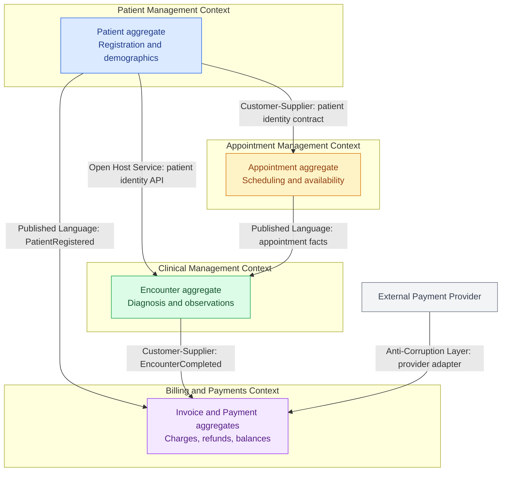

# Context Map

## 1. Purpose

Describe how the four bounded contexts in
[bounded-contexts.md](bounded-contexts.md) relate to one another: which context
is upstream, which is downstream, what crosses the boundary, and which context
mapping pattern governs the integration.

This is a conceptual map, not an implementation dependency diagram. The first
implementation uses application-level interfaces and in-process domain events;
it does not use a message broker or separate services.

## 2. Cross-context dependencies

| Consumer (downstream) | Needs | Provider (upstream) | Information crossing the boundary |
|---|---|---|---|
| Appointment Management | Proof that a patient is registered | Patient Management | Patient identity and registration status |
| Clinical Management | Patient identity for an encounter | Patient Management | `patient_id` and the identity subset from the patient API |
| Clinical Management | Context for a consultation | Appointment Management | `appointment_id`, `doctor_id`, and scheduled period |
| Billing & Payments | Patient registration facts | Patient Management | `PatientRegistered` event |
| Billing & Payments | Billable services | Clinical Management | `EncounterCompleted` event with billable items |
| Billing & Payments | External transaction results | External payment provider | Provider-specific status and amount, translated at the boundary |

Each context keeps only the information it needs. No context reads another
context's tables or receives another context's aggregate object.

## 3. Context map diagram



Arrows point from upstream to downstream. The external provider is shown outside
the four internal contexts because its model is not ours.

## 4. Selected relationships and patterns

| Relationship | Upstream | Downstream | Pattern | Reason |
|---|---|---|---|---|
| Patient → Appointment | Patient Management | Appointment Management | Customer-Supplier | Booking needs confirmation of patient registration |
| Patient → Clinical | Patient Management | Clinical Management | Open Host Service | Clinical needs a stable patient identity interface |
| Patient → Billing | Patient Management | Billing & Payments | Published Language | Billing needs registration facts without the patient model |
| Appointment → Clinical | Appointment Management | Clinical Management | Published Language | Clinical needs appointment facts without the appointment model |
| Clinical → Billing | Clinical Management | Billing & Payments | Customer-Supplier | Billing needs billable clinical services |
| External provider → Billing | External Payment Provider | Billing & Payments | Anti-Corruption Layer | Protect our billing model from provider terminology |

These are initial choices. A pattern is changed by updating this map and
[architecture-decisions.md](architecture-decisions.md), not by changing code
silently.

## 5. Pattern comparison

| Pattern | Main idea | Clinic example | Initial decision |
|---|---|---|---|
| Shared Kernel | Share a small part of the model | Common `PatientId` / `DoctorId` definitions | Keep identifiers small and by value; no shared domain package |
| Customer-Supplier | Downstream depends on upstream | Appointment → Patient; Billing → Clinical | Selected |
| Conformist | Accept the upstream model unchanged | Consume the patient contract directly in clinical code | Rejected: stronger coupling to upstream terminology |
| Anti-Corruption Layer | Translate foreign models | External provider → Billing | Selected |
| Published Language | Communicate through an agreed contract | `PatientRegistered`, `EncounterCompleted` | Selected |
| Open Host Service | Provide a stable service others consume | Patient identity API | Selected |
| Separate Ways | Do not integrate when no capability requires it | Independent internal reporting models | Allowed case by case |

## 6. Contracts by relationship

### 6.1 Patient Management → Appointment Management

Patient Management is the supplier of a narrow contract that answers one
question for the customer: is this patient registered and active? The
contract belongs to the application boundary, not to the `Patient` aggregate.
Appointment Management stores the returned `patient_id`; it does not store a
copy of the patient's demographics.

### 6.2 Patient Management → Clinical Management

Patient Management offers a stable read interface for patient identity, for
example `GET /patients/{patient_id}`. Clinical Management translates the
response into its own local patient reference and never imports the patient
domain model. The interface is an Open Host Service: its shape is designed for
consumers, not derived from internal patient classes.

### 6.3 Patient Management → Billing & Payments

Billing receives published facts such as:

```python
from dataclasses import dataclass
from datetime import datetime
from uuid import UUID


@dataclass(frozen=True)
class PatientRegistered:
    patient_id: UUID
    occurred_at: datetime
```

Billing keeps the registration fact it needs for an invoice. It does not gain
the right to update the patient record.

### 6.4 Appointment Management → Clinical Management

Appointment facts are published after a successful booking and after
completion. The existing event vocabulary in
[`../domain/domain-events.md`](../domain/domain-events.md) defines
`AppointmentBooked`; `AppointmentCompleted` is a future event in that document.
Clinical Management uses these facts to link an `Encounter` to the visit that
caused it.

### 6.5 Clinical Management → Billing & Payments

When an encounter is completed, Clinical publishes a fact describing the
billable services. Billing decides whether and how to invoice; Clinical never
creates or modifies an invoice.

```python
from dataclasses import dataclass
from datetime import datetime
from uuid import UUID
from decimal import Decimal


@dataclass(frozen=True)
class EncounterCompleted:
    encounter_id: UUID
    patient_id: UUID
    billable_amount: Decimal
    occurred_at: datetime
```

`Decimal` is shown here as a placeholder only. Billing owns the `Money` value
object and replaces the amount with it inside its own model.

### 6.6 External payment provider → Billing & Payments

The provider returns foreign terminology such as `customer_reference` and
`invoice_state`. An adapter translates those values into Billing's own
`InvoiceStatus` before any domain code sees them.

```python
from enum import Enum


class InvoiceStatus(Enum):
    DRAFT = "draft"
    ISSUED = "issued"
    PAID = "paid"
    OVERDUE = "overdue"


_PROVIDER_STATUS = {
    "PAID": InvoiceStatus.PAID,
    "PENDING": InvoiceStatus.ISSUED,
}


def translate_invoice_status(external_status: str) -> InvoiceStatus:
    try:
        return _PROVIDER_STATUS[external_status]
    except KeyError as exc:
        raise ValueError("Unsupported invoice status") from exc
```

Unsupported provider values fail in the adapter, not in the domain model. The
same boundary translates provider amounts into `Money` and provider references
into our `patient_id` and `invoice_id`.

## 7. Communication in the modular monolith

| Mechanism | Use |
|---|---|
| Application interface (port) | One context asks another for a fact it needs now |
| Domain event published in-process | One context records what happened; others react |
| Adapter at an external boundary | Translate foreign models and terminology |

There is one application and one deployment. Events are dispatched in process
after the producing aggregate is saved, following the order described in
[`../domain/domain-events.md`](../domain/domain-events.md). Handlers must be
idempotent because a dispatch can be retried. A transactional outbox is the
planned reliability improvement; Kafka, RabbitMQ, and microservices are not
part of this step.

Only events intended for other contexts are published. An aggregate's internal
events stay inside its own context.

## 8. End-to-end workflow

| Step | Capability | Crossing |
|---|---|---|
| 1. Patient registers | Patient Management | Publishes `PatientRegistered` |
| 2. Patient books an appointment | Appointment Management | Consults the patient identity contract; publishes `AppointmentBooked` |
| 3. Appointment is completed | Appointment Management | Publishes `AppointmentCompleted` |
| 4. Practitioner records a consultation | Clinical Management | Uses patient identity and appointment facts; owns the encounter |
| 5. Encounter is completed | Clinical Management | Publishes `EncounterCompleted` |
| 6. Clinic generates an invoice | Billing & Payments | Uses `PatientRegistered` and `EncounterCompleted`; owns the invoice |
| 7. Patient makes a payment | Billing & Payments | Uses the ACL to read provider results; owns the payment |

Each step changes state only in the context that owns it.

## 9. Forbidden coupling

```text
Rejected: clinical code imports Patient from patient_management.domain
Rejected: appointment code updates a patient row directly
Rejected: billing code imports Encounter to mutate clinical records
Rejected: a provider DTO is stored as a billing domain object
```

If information is needed, use the interface, event, or adapter defined in this
map. If no integration is needed, use Separate Ways and keep the models
independent.

## 10. Verification checklist

- [x] All four contexts and their relationships appear in the Mermaid diagram.
- [x] Each relationship identifies upstream, downstream, and pattern.
- [x] Cross-context dependencies list the information that actually crosses.
- [x] Published contracts are immutable facts, not internal domain objects.
- [x] External terminology is translated before it reaches the domain.
- [x] Direct cross-context model and table access are explicitly rejected.

## 11. Related documents

- [bounded-contexts.md](bounded-contexts.md) — context responsibilities and
  ownership.
- [architecture-decisions.md](architecture-decisions.md) — why these patterns
  were chosen.
- [`../domain/domain-events.md`](../domain/domain-events.md) — event vocabulary
  and delivery concerns.
- [`../domain/application-services.md`](../domain/application-services.md) —
  application ports and use-case coordination.
