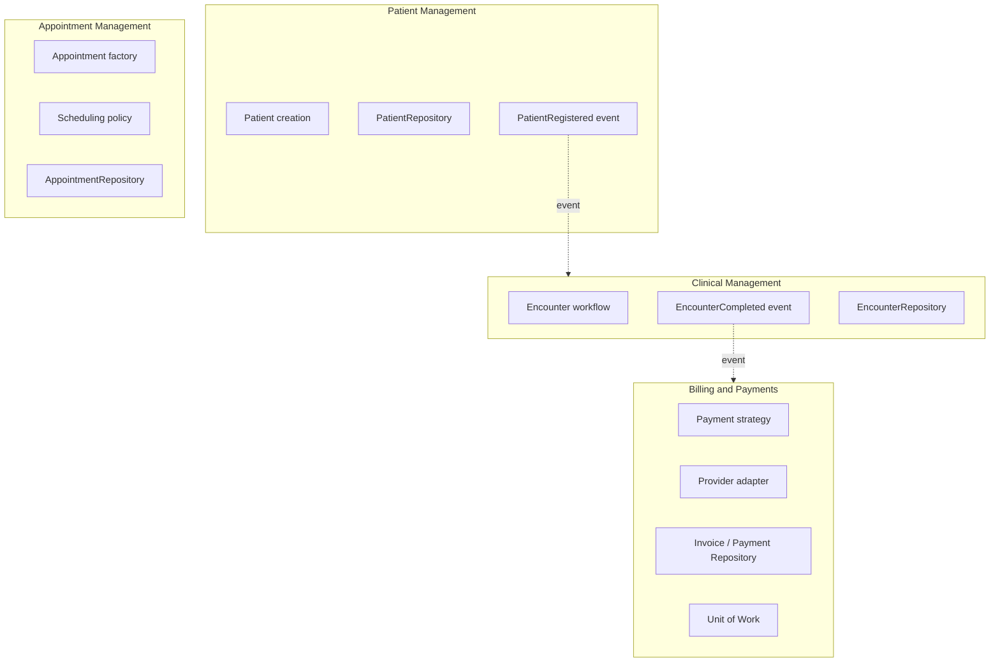
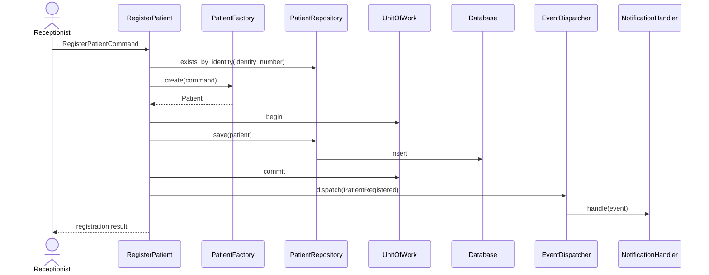

# Design Patterns

## 1. Purpose

Design patterns are reusable solutions to recurring design problems. They help
decide how objects are created, how components communicate, and where
responsibilities belong.

As `clinic-system` grows, we face recurring challenges: creating complex domain
objects, supporting multiple payment methods, integrating external services,
managing transactions, keeping business logic free of infrastructure, and
coordinating workflows. This document defines the patterns we will use, shows
Python implementations, and decides which patterns we will actually adopt.

This is design guidance, not a mandate to implement every pattern. Examples are
illustrative; no production pattern code exists yet. Earlier decisions in
[bounded-contexts.md](bounded-contexts.md),
[layered-architecture.md](layered-architecture.md), and
[solid-principles.md](solid-principles.md) still apply.

## 2. Categories

| Category | Problem addressed | Patterns discussed |
|---|---|---|
| Creational | How objects are created | Factory, Builder |
| Structural | How objects and systems are composed | Adapter, Facade |
| Behavioral | How objects communicate and delegate work | Strategy, Observer |
| Enterprise application | How persistence and transactions are organized | Repository, Unit of Work |

Singleton is sometimes listed as a creational pattern, but we do not adopt it:
global mutable state makes tests order-dependent and hides dependencies.

Repository and Unit of Work are architectural patterns, not part of the original
Gang of Four catalogue.

## 3. Creational patterns

### 3.1 Factory

**Definition:** centralize object creation when different types or
configurations require different construction logic.

Without a factory, type checks spread across the application:

```python
if appointment_type == "consultation":
    appointment = ConsultationAppointment(...)
elif appointment_type == "follow_up":
    appointment = FollowUpAppointment(...)
```

In our domain there is one `Appointment` aggregate with an `AppointmentType`
value object, not one aggregate subclass per appointment type. A factory, if
introduced, configures the single aggregate:

```python
class AppointmentFactory:
    @staticmethod
    def create(
        appointment_id: UUID,
        patient_id: UUID,
        doctor_id: UUID,
        time_slot: TimeSlot,
    ) -> Appointment:
        return Appointment.book(
            appointment_id=appointment_id,
            patient_id=patient_id,
            doctor_id=doctor_id,
            time_slot=time_slot,
        )
```

The factory delegates to `Appointment.book(...)`, so invariants are still
enforced. Appointment types are `AppointmentType` value objects carried by the
command, not aggregate subclasses. If type-specific construction becomes real,
the factory can select that configuration here.

**When to use:** creating different appointment configurations, selecting an
implementation from configuration, or centralizing complex construction.

**DDD connection:** a factory helps create complex aggregates while preserving
their invariants.

### 3.2 Builder

**Definition:** construct an object with many optional attributes through fluent
steps instead of a long positional constructor.

```python
patient = Patient(
    "P-100", "John", "Smith", "1990-01-01", "Toronto",
    "1234567890", "emergency@example.com",
)
```

The positional form is hard to read. A builder names each step:

```python
class PatientBuilder:
    def __init__(self) -> None:
        self.data: dict[str, object] = {}

    def with_id(self, patient_id: UUID) -> "PatientBuilder":
        self.data["patient_id"] = patient_id
        return self

    def with_name(self, first_name: str, last_name: str) -> "PatientBuilder":
        self.data["first_name"] = first_name
        self.data["last_name"] = last_name
        return self

    def with_date_of_birth(self, date_of_birth: date) -> "PatientBuilder":
        self.data["date_of_birth"] = date_of_birth
        return self

    def build(self) -> Patient:
        return Patient.register(**self.data)
```

`build()` delegates to domain creation. A builder must never become a way to
bypass `PatientName`, `DateOfBirth`, or identifier rules.

**When to use:** test fixtures, complex documents or reports, and objects with
many optional configuration values. For simple domain entities, the named
factory method `Patient.register(...)` is clearer.

## 4. Structural patterns

### 4.1 Adapter

**Definition:** translate one interface into another so incompatible systems
can work together.

Our Application layer expects a payment gateway:

```python
class PaymentGateway(Protocol):
    def charge(self, amount: Money, currency: str) -> None: ...


class ExternalPaymentProvider:
    def make_transaction(self, value: str, currency_code: str) -> None: ...


class PaymentProviderAdapter:
    def __init__(self, provider: ExternalPaymentProvider) -> None:
        self.provider = provider

    def charge(self, amount: Money, currency: str) -> None:
        self.provider.make_transaction(
            value=str(amount),
            currency_code=currency,
        )
```

The application keeps its own contract. Provider terms such as
`customer_reference`, `invoice_state`, `value`, and `currency_code` stay inside
the adapter. This is the concrete implementation of the Anti-Corruption Layer
chosen in [context-map.md](context-map.md).

**When to use:** external payment providers, insurance systems, third-party
healthcare integrations, legacy systems, and interchangeable notification
providers.

### 4.2 Facade

**Definition:** give a complex subsystem one simple entry point.

Completing an encounter may touch validation, notes, status, events, and a
billing workflow. The caller should not need to know that sequence. In our
architecture, this coordination is an Application use case:

```python
class CompleteEncounter:
    def __init__(
        self,
        encounter_repository: "EncounterRepository",
        notes: "ClinicalNoteService",
        publisher: "EventPublisher",
    ) -> None:
        self.encounter_repository = encounter_repository
        self.notes = notes
        self.publisher = publisher

    def execute(self, command: object) -> "Encounter":
        self.notes.validate(command.encounter_id)
        encounter = self.encounter_repository.get_by_id(command.encounter_id)
        encounter.complete()
        self.encounter_repository.save(encounter)
        self.publisher.dispatch(EncounterCompleted(...))
        return encounter
```

The published event carries identities, amount, and timestamp as defined in
[context-map.md](context-map.md); details are omitted here.

A use case is a facade in effect. Do not add a second facade class merely to
rename an ordinary use case, and do not let the facade make business decisions.
The aggregate owns the status transition.

**When to use:** complex workflows, external integrations, and reporting.

## 5. Behavioral patterns

### 5.1 Strategy

**Definition:** define a family of interchangeable algorithms and let the client
choose one at runtime.

Without Strategy, adding a method modifies the service:

```python
class PaymentService:
    def process(self, payment_type: str, amount: Money) -> None:
        if payment_type == "cash":
            ...
        elif payment_type == "card":
            ...
```

With Strategy, the service depends on a contract:

```python
class PaymentProcessor(Protocol):
    def process(self, amount: Money) -> None: ...


class CashPaymentProcessor:
    def process(self, amount: Money) -> None: ...


class CardPaymentProcessor:
    def process(self, amount: Money) -> None: ...


class PaymentService:
    def __init__(self, processor: PaymentProcessor) -> None:
        self.processor = processor

    def process_payment(self, amount: Money) -> None:
        self.processor.process(amount)
```

Switching implementations happens at the composition root, not inside the
service. `Money` is Billing's value object; the examples in earlier steps that
used `int` were simplified.

Insurance claim submission is **not** a `PaymentProcessor` strategy: it does not
execute a direct payment. It remains a separate operation, as decided in
[solid-principles.md](solid-principles.md).

**When to use:** payment processors, pricing policies, notification channels,
scheduling policies, and insurance claim processing rules.

**DDD connection:** Strategy fits interchangeable domain policies.

### 5.2 Observer

**Definition:** publish an event and let interested subscribers react without
the publisher knowing who they are.

```python
from dataclasses import dataclass
from datetime import datetime
from uuid import UUID


@dataclass(frozen=True)
class PatientRegistered:
    patient_id: UUID
    occurred_at: datetime


class EventHandler(Protocol):
    def handle(self, event: object) -> None: ...


class EventDispatcher:
    def __init__(self) -> None:
        self.handlers: dict[type, list[EventHandler]] = {}

    def subscribe(self, event_type: type, handler: EventHandler) -> None:
        self.handlers.setdefault(event_type, []).append(handler)

    def dispatch(self, event: object) -> None:
        for handler in self.handlers.get(type(event), []):
            handler.handle(event)
```

Handlers perform reactions such as notifications, audit logging, or read-model
updates. The aggregate records the fact; it does not call those services.

This dispatcher is educational. Production delivery must dispatch only after a
successful save, expect idempotent handlers, and use the transactional outbox
described in [`../domain/domain-events.md`](../domain/domain-events.md).

**When to use:** domain event handling, notifications, audit logging, read-model
projections, and reactions to completed appointments.

## 6. Enterprise application patterns

### 6.1 Repository

**Definition:** mediate between the domain and data storage with a
collection-like interface for aggregate roots.

```python
from typing import Protocol
from uuid import UUID


class PatientRepository(Protocol):
    def save(self, patient: "Patient") -> None: ...
    def get_by_id(self, patient_id: UUID) -> "Patient | None": ...
    def exists(self, patient_id: UUID) -> bool: ...


class InMemoryPatientRepository:
    def __init__(self) -> None:
        self.items: dict[UUID, "Patient"] = {}

    def save(self, patient: "Patient") -> None:
        self.items[patient.patient_id] = patient

    def get_by_id(self, patient_id: UUID) -> "Patient | None":
        return self.items.get(patient_id)

    def exists(self, patient_id: UUID) -> bool:
        return patient_id in self.items
```

The port is owned by the Domain Layer; implementations live in Infrastructure.
The in-memory version supports fast unit tests. A SQLAlchemy version maps the
aggregate to persistence tables without moving rules out of the domain.

**When to use:** patient, appointment, encounter, invoice, and payment
persistence.

**DDD connection:** repositories provide collection-like access to aggregate
roots.

### 6.2 Unit of Work

**Definition:** group multiple persistence operations into one transaction and
commit or roll them back together.

```python
class UnitOfWork:
    def __init__(self, session: object) -> None:
        self.session = session

    def commit(self) -> None:
        self.session.commit()

    def rollback(self) -> None:
        self.session.rollback()

    def __enter__(self) -> "UnitOfWork":
        return self

    def __exit__(self, exc_type: object, exc: object, traceback: object) -> None:
        if exc_type is not None:
            self.rollback()
        else:
            self.commit()
```

```python
with UnitOfWork(session) as uow:
    encounter_repository.save(encounter)
    clinical_note_repository.save(note)
```

Both repositories must share the same session for this to be one transaction.
A database transaction cannot make separate bounded contexts or an external
payment provider atomic. Cross-context workflows use events, eventual
consistency, and compensating actions; see
[context-map.md](context-map.md).

**When to use:** multiple aggregate updates within one context, invoice
creation, payment allocation, and encounter completion.

## 7. SOLID relationships

| Pattern | Supported principles |
|---|---|
| Factory | SRP: one place creates objects; DIP: callers depend on an abstraction |
| Builder | SRP: construction is separate from domain behavior |
| Adapter | OCP, LSP, DIP: new provider without changing our contract |
| Facade | ISP: one narrow entry point to a complex subsystem |
| Strategy | OCP, DIP: new policy without editing the client |
| Observer | OCP, DIP: new handler without editing the publisher |
| Repository | ISP, DIP: focused port, replaceable implementation |
| Unit of Work | SRP: transaction coordination is separate from business logic |

Patterns are ways of applying SOLID, not substitutes for it. A factory that
contains business rules or an observer that mutates the publisher violates the
same boundaries SOLID protects.

## 8. DDD applications

| Pattern | DDD application |
|---|---|
| Factory | Create complex aggregates while respecting invariants |
| Builder | Assemble optional data, mainly for fixtures and documents |
| Adapter | Implement an Anti-Corruption Layer for external models |
| Facade | Coordinate a use case across services in one context |
| Strategy | Represent interchangeable domain policies |
| Observer | Deliver domain events to interested handlers |
| Repository | Persist and reload aggregate roots by identity |
| Unit of Work | Keep changes within one transaction and one context |

## 9. Clinic context mapping

| Context | Patterns | Practical purpose |
|---|---|---|
| Patient Management | Factory, Repository, Observer | Create, persist, and announce registered patients |
| Appointment Management | Factory, Strategy, Repository | Configure appointments by type and apply scheduling policies |
| Clinical Management | Use case (facade), Observer, Repository | Complete encounters and publish clinical facts |
| Billing & Payments | Strategy, Adapter, Repository, Unit of Work | Process payments, translate provider models, persist finances |



Pattern placement is possible, not mandatory. The events shown here are the
published contracts in [context-map.md](context-map.md).

## 10. Patient registration with several patterns

| Requirement | Component | Pattern |
|---|---|---|
| Validate patient information | `Patient` | Entity / aggregate root |
| Create the aggregate | `PatientFactory` | Factory |
| Check the registration identity | `RegisterPatient` via `PatientRepository` | Use case and Repository |
| Save the patient | `SqlAlchemyPatientRepository` | Repository implementation |
| Manage the transaction | `UnitOfWork` | Unit of Work |
| Publish the fact | `PatientRegistered` | Domain event |
| Notify subscribers | `EventDispatcher` and handlers | Observer |



Publishing after commit avoids announcing a fact that was never saved. If the
event must survive process failure between save and publish, use the outbox
rather than trusting this simple dispatcher.

## 11. Decisions: which patterns we will use

| Pattern | Decision | Reason |
|---|---|---|
| Factory | Adopt narrowly | Centralize configuration of complex aggregates; prefer `Patient.register(...)` for simple cases |
| Builder | Defer | Registration is simple; use it for test fixtures or complex documents when needed |
| Adapter | Adopt | Every external provider needs an Anti-Corruption Layer |
| Facade | Defer | Application use cases already coordinate workflows; avoid a duplicate wrapper |
| Strategy | Adopt | Payment processors, pricing policies, and notification channels have real variants |
| Observer | Adopt | Domain events already have a dispatcher and handlers |
| Repository | Adopt | Already required by the layered architecture |
| Unit of Work | Adopt within one context | Transactions are local; cross-context work stays eventually consistent |
| Singleton | Reject | Hidden global state and order-dependent tests |

We introduce a pattern when a recurring problem exists, not because it appears
in a catalogue. A new abstraction needs a concrete second implementation or a
clear extension point.

## 12. Guardrails

- A factory or builder must not bypass aggregate invariants.
- A strategy must honor its contract; insurance claims are not payment
  processors.
- An adapter translates foreign models; it never stores them as domain objects.
- A facade coordinates but owns no business rules.
- An observer never makes the publisher depend on handlers.
- A repository stays focused on one aggregate root.
- A Unit of Work never implies a transaction across bounded contexts or an
  external provider.

## 13. Verification checklist

- [x] Pattern definitions and three categories are given.
- [x] Creational, structural, behavioral, and enterprise patterns have Python
      implementations.
- [x] SOLID relationships and DDD applications are mapped.
- [x] Patterns are mapped to the four clinic contexts.
- [x] Patient registration shows patterns working together.
- [x] Adopted, deferred, and rejected patterns are decided with reasons.

## 14. Related documents

- [bounded-contexts.md](bounded-contexts.md) — context ownership and aggregate
  roots.
- [context-map.md](context-map.md) — events, ACL, and eventual consistency.
- [layered-architecture.md](layered-architecture.md) — ports, implementations,
  and dependency direction.
- [solid-principles.md](solid-principles.md) — SOLID decisions behind these
  patterns.
- [`../domain/domain-events.md`](../domain/domain-events.md) — event dispatch
  order and outbox plan.
