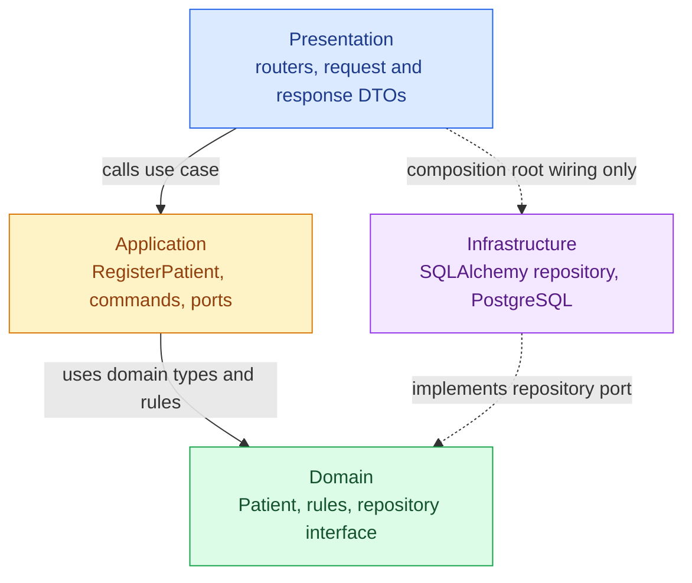
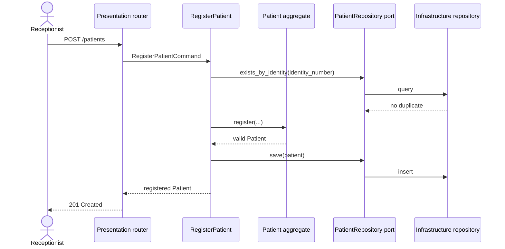

# Layered Architecture

## 1. Purpose

Define how the internals of each bounded context are organized. Step 10 fixed
the horizontal boundaries between contexts; this document fixes the vertical
boundaries inside a context.

The goal is to keep business rules independent of technical implementation. A
`Patient` entity must not validate registration, open a database connection,
handle an HTTP request, send email, and calculate business rules at the same
time. Each of those concerns has one layer and one owner.

This is a design document. No production layer code exists yet; the code shown
is illustrative and follows the conventions in
[`../domain/`](../domain/README.md).

## 2. Two architectural dimensions

| Dimension | Organization |
|---|---|
| Horizontal — bounded contexts | Patient Management, Appointment Management, Clinical Management, Billing & Payments |
| Vertical — layers | Presentation, Application, Domain, Infrastructure |

Both dimensions apply at once: **each bounded context has its own four layers**.
There is no single shared Domain Layer for the whole clinic. Cross-context
communication uses the contracts in [context-map.md](context-map.md), not shared
domain classes.

## 3. The four layers

| Layer | Responsibility | Typical components |
|---|---|---|
| Presentation | Receive requests and present responses | FastAPI routers, controllers, request schemas, response DTOs |
| Application | Coordinate use cases | Application services, commands, repository ports, event dispatch |
| Domain | Represent the business and enforce its rules | Entities, value objects, aggregates, domain services, domain events, repository interfaces |
| Infrastructure | Implement technical capabilities | PostgreSQL, SQLAlchemy models, repository implementations, email, external adapters |

### 3.1 Presentation Layer

Receives input from users or other systems and returns a result. It parses and
authorizes the request, builds a command, delegates to the Application Layer,
and serializes the response.

A FastAPI router is thin:

```python
from fastapi import APIRouter

router = APIRouter()


@router.post("/patients")
def register_patient(request: dict) -> dict:
    ...
```

The router does not decide what a valid patient is, does not generate a patient
identifier, and does not write to a database. Request field validation protects
the boundary; business validation stays in the Domain Layer.

### 3.2 Application Layer

Coordinates one use case: something an actor is allowed to accomplish, such as
`RegisterPatient`, `CancelAppointment`, `CompleteEncounter`, or `RecordPayment`.
It retrieves what is needed, calls domain behavior, saves through a repository
port, and dispatches recorded events. It owns no business rules.

```python
class RegisterPatient:
    def __init__(self, patient_repository) -> None:
        self.patient_repository = patient_repository

    def execute(self, command) -> object:
        patient = Patient.register(
            patient_id=command.patient_id,
            first_name=command.first_name,
            last_name=command.last_name,
            date_of_birth=command.date_of_birth,
        )
        self.patient_repository.save(patient)
        return patient
```

This use case does not know whether the patient is saved in PostgreSQL, SQLite,
or anywhere else. It depends on an abstraction. The complete `RegisterPatient`
flow in section 7 also checks for an existing identifier before creation. See
[`../domain/application-services.md`](../domain/application-services.md) for the
booking equivalent and its ordering rules.

### 3.3 Domain Layer

The most important layer. It represents the business and enforces its rules:

- entities and value objects;
- aggregates and aggregate roots;
- domain services, domain events, and repository interfaces.

```python
class Patient:
    def __init__(
        self,
        patient_id: str,
        first_name: str,
        last_name: str,
    ) -> None:
        if not patient_id:
            raise ValueError("Patient ID is required")
        if not first_name:
            raise ValueError("First name is required")
        if not last_name:
            raise ValueError("Last name is required")
        self.patient_id = patient_id
        self.first_name = first_name
        self.last_name = last_name
```

The Domain Layer must not import FastAPI, SQLAlchemy, PostgreSQL drivers, HTTP
request objects, or web framework components. It uses domain types and domain
language only, so business rules survive infrastructure changes.

### 3.4 Infrastructure Layer

Implements the technical capabilities the application needs: database
connections, ORM models, repository implementations, email delivery, file
storage, and external-service adapters.

It depends inward on the abstractions defined by inner layers. An external
payment provider adapter also implements the Anti-Corruption Layer described in
[context-map.md](context-map.md).

## 4. Dependency direction

Dependency arrows point **inward, toward business policy**. The traditional
layer diagram can mislead: the Domain Layer does not depend on Infrastructure.
Infrastructure depends on the Domain because it implements a port declared
there.



Solid arrows are compile-time dependencies. Dotted arrows show wiring at the
composition root and the implementation relationship; the Domain Layer has no
outward dependency.

| Component | Depends on |
|---|---|
| FastAPI router | Application use case and its command/DTO |
| Application use case | Domain model and repository abstraction |
| Domain entity | Domain concepts only |
| SQLAlchemy repository | Repository abstraction and persistence technology |

If PostgreSQL is replaced, the Domain and Application layers do not change.
Only the repository implementation and infrastructure configuration change.
That is dependency inversion.

## 5. Repository abstraction

The port belongs to the Domain Layer; its implementation belongs to
Infrastructure. Application code depends only on the port.

```python
from typing import Protocol
from uuid import UUID


class PatientRepository(Protocol):
    def exists(self, patient_id: UUID) -> bool: ...
    def save(self, patient: "Patient") -> None: ...
    def get_by_id(self, patient_id: UUID) -> "Patient | None": ...
```

`Patient` is the aggregate root in the Domain Layer. The interface speaks the
language of the domain; it contains no SQL, no session, and no ORM type.

```python
from uuid import UUID

from sqlalchemy.orm import Session

from clinic_system.patient_management.domain.entities.patient import Patient


class SqlAlchemyPatientRepository:
    def __init__(self, session: Session) -> None:
        self.session = session

    def exists(self, patient_id: UUID) -> bool:
        ...

    def save(self, patient: Patient) -> None:
        ...

    def get_by_id(self, patient_id: UUID) -> Patient | None:
        ...
```

The infrastructure import of `Patient` points inward, which is allowed; the
Domain Layer makes no matching outward import. The implementation maps a domain
object to a persistence model, writes through the session, and reconstructs the
domain object on reads. It contains no
registration rules; those stay in `Patient` and its value objects. Application
tests can replace the port with an in-memory or mock implementation.

## 6. DDD and Clean Architecture

DDD models the business; Clean Architecture organizes the software so that the
model stays independent of technology.

| DDD concept | Contribution to the architecture |
|---|---|
| Bounded Context | Organizes business boundaries |
| Entity | Represents domain identity |
| Value Object | Represents domain values |
| Aggregate | Protects consistency boundaries |
| Domain Service | Encapsulates domain operations that span aggregates |
| Domain Event | Represents a business fact that has happened |
| Repository | Abstracts aggregate persistence behind a port |
| Use Case | Coordinates application behavior |
| Dependency Inversion | Protects inner business layers from outer technologies |

The layers do not replace aggregates or contexts. A `Patient` aggregate lives
inside the Domain Layer of Patient Management; `RegisterPatient` lives in that
context's Application Layer.

## 7. RegisterPatient across the layers

### 7.1 Business requirement

A receptionist must be able to register a new patient. The system must require a
unique registration identity (`identity_number`), a first name, and a last name;
validate the date of birth; prevent duplicate registration identities; save the
patient; and return the registered patient.

This follows the requirements in
[`../requirements/use-cases.md`](../requirements/use-cases.md) and the rules in
[`../domain/domain-rules.md`](../domain/domain-rules.md). Duplicate registration
identities (BR-PAT-001) are distinct from possible duplicate *people*
(BR-PAT-004), which require review.

### 7.2 Responsibility split

| Operation | Layer | Component |
|---|---|---|
| Receive `POST /patients` | Presentation | FastAPI router |
| Authorize and parse input | Presentation | Router and request schema |
| Build `RegisterPatientCommand` | Presentation | Router |
| Check for an existing registration identity | Application | `RegisterPatient` through `PatientRepository` |
| Enforce registration identity, name, and date-of-birth rules | Domain | `Patient`, `PatientName`, `DateOfBirth` |
| Create the registered patient | Domain | `Patient.register(...)` |
| Persist the aggregate | Application then Infrastructure | Use case calls the port; repository implements it |
| Serialize the result | Presentation | Router and response DTO |

### 7.3 Flow



If the registration identity already exists, the use case rejects the command
before creation: no `Patient` is saved and no success response is returned.
Invalid domain data fails inside `Patient.register(...)`.

## 8. Proposed module structure

The target structure applies the four layers inside each context:

```text
src/clinic_system/
├── patient_management/
│   ├── presentation/
│   ├── application/
│   ├── domain/
│   │   ├── entities/
│   │   ├── value_objects/
│   │   ├── aggregates/
│   │   ├── services/
│   │   ├── events/
│   │   └── repositories/
│   └── infrastructure/
│       ├── persistence/
│       └── repositories/
├── appointment_management/{presentation,application,domain,infrastructure}/
├── clinical_management/{presentation,application,domain,infrastructure}/
├── billing/{presentation,application,domain,infrastructure}/
└── shared/

tests/
├── unit/
├── integration/
└── architecture/
```

This is a target, not an instruction to create every folder now. Architecture
tests in `tests/architecture/` should enforce that the Domain Layer imports no
FastAPI, SQLAlchemy, or other context's domain code.

## 9. Dependency violations

| Violation | Why it is wrong | Correction |
|---|---|---|
| Domain entity imports FastAPI | Ties business rules to HTTP | Move request handling to Presentation |
| Domain entity imports SQLAlchemy | Ties business rules to persistence | Define a repository port; implement it in Infrastructure |
| Application use case opens a database session | Couples workflow to a technology | Inject the repository port |
| Repository implementation decides registration rules | Rules become invisible to domain tests | Keep rules in `Patient` and its value objects |
| Router calls the repository directly | Skips use-case coordination | Router calls the Application use case |
| One shared Domain Layer for all contexts | Recreates the coupled model removed in Step 10 | Keep a Domain Layer inside each context |

## 10. Verification checklist

- [x] The four layers and their responsibilities are explained.
- [x] `RegisterPatient` operations are mapped to layers.
- [x] Dependency violations and their corrections are recorded.
- [x] `PatientRepository` is defined as a domain port with an infrastructure
      implementation.
- [x] The dependency diagram points inward toward business policy.
- [x] DDD and Clean Architecture are explained as complementary approaches.

## 11. Related documents

- [bounded-contexts.md](bounded-contexts.md) — context ownership and aggregate
  roots.
- [context-map.md](context-map.md) — cross-context contracts and events.
- [architecture-decisions.md](architecture-decisions.md) — modular monolith and
  integration decisions.
- [`../domain/application-services.md`](../domain/application-services.md) —
  use-case coordination and ports.
- [`../domain/domain-events.md`](../domain/domain-events.md) — event recording
  and dispatch after save.
- [`../requirements/use-cases.md`](../requirements/use-cases.md) —
  `RegisterPatient` requirements.
