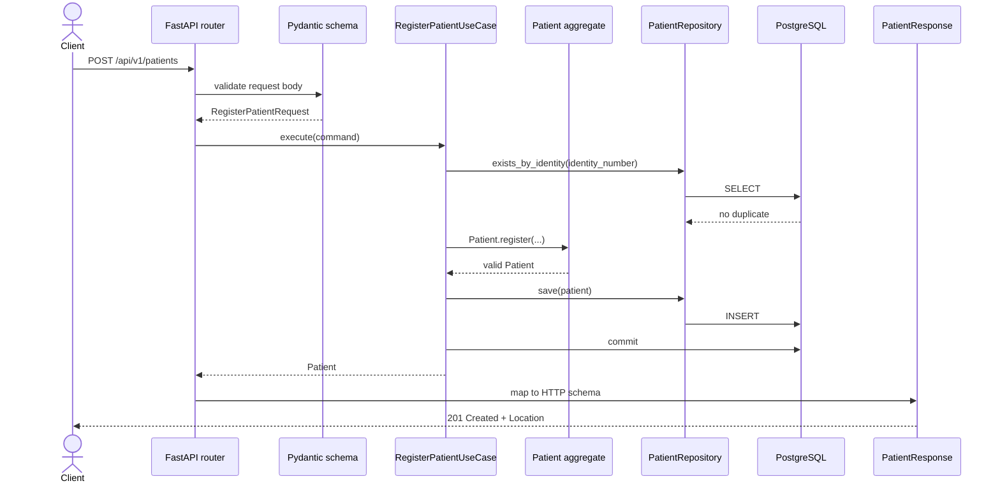

# Presentation Layer & REST API Design

## 1. Presentation Layer Responsibilities

The Presentation Layer is the boundary between external HTTP clients and the
application. In `clinic-system`, it is implemented with FastAPI and Pydantic.

| Responsibility | Example |
|---|---|
| HTTP routing | `POST /api/v1/patients` |
| Request validation | Required `first_name`, valid `UUID` path parameter |
| Response formatting | Return `PatientResponse` with `201 Created` |
| Authentication | Verify user credentials later |
| Error translation | Duplicate identity becomes HTTP `409` |
| API documentation | OpenAPI, Swagger UI, ReDoc |

Dependency direction:

```text
Presentation --> Application --> Domain
                     ^
                     |
               Infrastructure
               implements ports
```

The Presentation Layer may:

- read and validate an HTTP request;
- map a request schema into an application command;
- call an application use case through an injected dependency;
- map the returned domain object into a response schema;
- translate known application exceptions into HTTP responses.

It must not:

- import SQLAlchemy or open a database session;
- call a repository directly;
- manage transactions;
- implement patient registration rules;
- decide whether an appointment is valid;
- contain domain entities or business logic.

The route is thin. It coordinates HTTP concerns and delegates the workflow.

## 2. REST API Conventions and Endpoint List

Resources are nouns: `patients`, `appointments`, `encounters`, `invoices`.
Actions are represented by HTTP methods, not by verbs in URLs.

Version all routes with `/api/v1`.

| Method | Endpoint | Purpose | Success |
|---|---|---|---|
| `POST` | `/api/v1/patients` | Register a patient | `201 Created` |
| `GET` | `/api/v1/patients/{patient_id}` | Retrieve a patient | `200 OK` |
| `PATCH` | `/api/v1/patients/{patient_id}` | Update selected fields | Deferred |
| `DELETE` | `/api/v1/patients/{patient_id}` | Deactivate/remove per policy | Deferred |

Only `POST` and `GET` are designed now because those use cases and repository
contracts already exist.

HTTP status conventions:

| Status | Meaning | Clinic example |
|---|---|---|
| `200 OK` | Retrieval succeeded | Patient returned |
| `201 Created` | New resource created | Patient registered |
| `204 No Content` | Success without a body | Future deactivation |
| `400 Bad Request` | Application-level bad request | Malformed business input |
| `404 Not Found` | Resource missing | Unknown `patient_id` |
| `409 Conflict` | State conflict | Duplicate `identity_number` |
| `422 Unprocessable Content` | Schema validation failed | Missing `first_name`, invalid `UUID` |
| `500 Internal Server Error` | Unexpected failure | Unhandled server fault |

Distinguish validation from conflict:

| Case | Status | Owner |
|---|---|---|
| Missing required field | `422` | FastAPI/Pydantic |
| Duplicate registration identity | `409` | Application exception |
| Unknown patient ID | `404` | Application exception |
| Unexpected database failure | `500` | Generic server response |

Never expose raw SQL errors, credentials, stack traces, or internal module names
to clients.

Install HTTP dependencies from the repository root when implementation starts:

```bash
uv add fastapi "uvicorn[standard]"
uv add --dev httpx pytest
```

Run the development server:

```bash
uv run uvicorn src.clinic_system.main:app --reload
```

The package path assumes `src/clinic_system/`, matching the target structure.

## 3. Request and Response Schema Design

There are three different representations of patient data:

| Representation | Purpose | Location |
|---|---|---|
| API schema | HTTP request/response contract | `presentation/api/schemas` |
| Application command | Input to a use case | `application/commands` |
| Domain model | Business state and invariants | `domain/entities` |

They must not be the same class.

Suggested target folder:

```text
src/clinic_system/patient_management/presentation/api/schemas/patients.py
```

Request schema:

```python
from datetime import date

from pydantic import BaseModel, ConfigDict, Field


class RegisterPatientRequest(BaseModel):
    model_config = ConfigDict(str_strip_whitespace=True)

    identity_number: str = Field(min_length=1, max_length=50)
    first_name: str = Field(min_length=1, max_length=100)
    last_name: str = Field(min_length=1, max_length=100)
    date_of_birth: date
    email: str = Field(min_length=1, max_length=255)
    street: str = Field(min_length=1, max_length=200)
    city: str = Field(min_length=1, max_length=100)
    province: str = Field(min_length=1, max_length=100)
    postal_code: str = Field(min_length=1, max_length=20)
    country: str = Field(min_length=1, max_length=100)
```

`date_of_birth` and `email` are included because the current
`RegisterPatientCommand` and `Patient.register(...)` contract requires them.
The lesson's shorter example is adapted here to the established domain model.

Response schema:

```python
from datetime import date
from uuid import UUID

from pydantic import BaseModel


class PatientResponse(BaseModel):
    id: UUID
    identity_number: str
    first_name: str
    last_name: str
    date_of_birth: date
    email: str
    street: str
    city: str
    province: str
    postal_code: str
    country: str
    active: bool
```

| API field | Domain source |
|---|---|
| `id` | `patient.patient_id` |
| `identity_number` | `patient.identity_number` |
| `first_name` | `patient.name.first_name` |
| `last_name` | `patient.name.last_name` |
| `date_of_birth` | `patient.date_of_birth.value` |
| `email` | `patient.email` |
| address fields | `patient.address.*` |
| `active` | `patient.active` |

Schema rules:

- Pydantic validates shape, types, lengths, and dates.
- Domain value objects validate business validity.
- Database constraints protect uniqueness under concurrency.
- A valid schema does not imply a valid business operation.

## 4. API-to-Application Mapping

The route maps an HTTP request into an application command. It does not build
domain objects and does not call the repository.

Current command shape from
[application-layer-use-cases.md](application-layer-use-cases.md):

```python
from dataclasses import dataclass
from datetime import date
from uuid import UUID


@dataclass(frozen=True)
class RegisterPatientCommand:
    patient_id: UUID
    identity_number: str
    first_name: str
    last_name: str
    date_of_birth: date
    email: str
    street: str | None = None
    city: str | None = None
    province: str | None = None
    postal_code: str | None = None
    country: str | None = None
```

Mapping in the route:

```python
from uuid import uuid4

command = RegisterPatientCommand(
    patient_id=uuid4(),
    identity_number=request.identity_number,
    first_name=request.first_name,
    last_name=request.last_name,
    date_of_birth=request.date_of_birth,
    email=request.email,
    street=request.street,
    city=request.city,
    province=request.province,
    postal_code=request.postal_code,
    country=request.country,
)
```

`patient_id` is generated as a technical aggregate identifier. If a future
upstream system supplies it, the request schema can expose it explicitly.

Mapping flow:

```text
RegisterPatientRequest
        |
        v
RegisterPatientCommand
        |
        v
RegisterPatientUseCase
        |
        v
Patient.register(...)
        |
        v
Patient aggregate
```

Response mapping:

```python
response_model = PatientResponse(
    id=patient.patient_id,
    identity_number=patient.identity_number,
    first_name=patient.name.first_name,
    last_name=patient.name.last_name,
    date_of_birth=patient.date_of_birth.value,
    email=patient.email,
    street=patient.address.street,
    city=patient.address.city,
    province=patient.address.province,
    postal_code=patient.address.postal_code,
    country=patient.address.country,
    active=patient.active,
)
```

If `Address` becomes optional in the domain, the response schema should use
nullable fields or a nested optional address object. The current API contract
requires address data.

## 5. Dependency Injection and Composition Root

The composition root selects concrete infrastructure implementations and injects
application use cases into routes.

Target structure:

```text
src/clinic_system/
├── main.py
├── infrastructure/
│   └── database.py
└── patient_management/
    ├── application/
    │   ├── commands/
    │   └── use_cases/
    ├── infrastructure/
    │   └── persistence/
    └── presentation/
        └── api/
            ├── dependencies.py
            ├── routes/
            │   └── patients.py
            └── schemas/
                └── patients.py
```

FastAPI dependencies file:

```python
from clinic_system.patient_management.application.use_cases.get_patient_by_id import (
    GetPatientByIdUseCase,
)
from clinic_system.patient_management.application.use_cases.register_patient import (
    RegisterPatientUseCase,
)
from clinic_system.patient_management.infrastructure.persistence.sqlalchemy_unit_of_work import (
    SqlAlchemyUnitOfWork,
)
from clinic_system.shared.infrastructure.persistence.database import (
    SessionFactory,
)


def get_unit_of_work_factory():
    def factory() -> SqlAlchemyUnitOfWork:
        return SqlAlchemyUnitOfWork(SessionFactory)

    return factory


def get_register_patient_use_case() -> RegisterPatientUseCase:
    return RegisterPatientUseCase(
        uow_factory=get_unit_of_work_factory(),
    )


def get_get_patient_by_id_use_case() -> GetPatientByIdUseCase:
    return GetPatientByIdUseCase(
        uow_factory=get_unit_of_work_factory(),
    )
```

The lesson's `SessionLocal` and `clinic_system.infrastructure.database` names
are schematic. The actual names here follow Step 17:
`SessionFactory` and `SqlAlchemyUnitOfWork`. The registration use case also
receives an `EventDispatcher` from the composition root.

Session rules:

- create a fresh Unit of Work for each use-case execution;
- never share one SQLAlchemy `Session` globally across requests;
- let the use case own the transaction with `with uow: ... uow.commit()`;
- let FastAPI inject use cases, not sessions, into routes.

Use-case shape:

```python
class RegisterPatientUseCase:
    def __init__(self, uow_factory, event_dispatcher) -> None:
        self._uow_factory = uow_factory
        self.event_dispatcher = event_dispatcher

    def execute(self, command: RegisterPatientCommand):
        with self._uow_factory() as uow:
            if uow.patient_repository.exists_by_identity(
                command.identity_number
            ):
                raise DuplicatePatientIdentityError(command.identity_number)

            patient = self._create_patient(command)
            uow.patient_repository.save(patient)
            uow.commit()
            events = patient.collect_events()

        for event in events:
            self.event_dispatcher.dispatch(event)

        return patient
```

The route does not manage `begin`, `commit`, `rollback`, or `close`.

Registration route:

```python
from uuid import UUID, uuid4

from fastapi import APIRouter, Depends, Response, status

from clinic_system.patient_management.application.commands.register_patient import (
    RegisterPatientCommand,
)
from clinic_system.patient_management.application.use_cases.register_patient import (
    RegisterPatientUseCase,
)
from clinic_system.patient_management.presentation.api.dependencies import (
    get_register_patient_use_case,
)
from clinic_system.patient_management.presentation.api.schemas.patients import (
    PatientResponse,
    RegisterPatientRequest,
)

router = APIRouter(prefix="/patients", tags=["Patients"])


@router.post(
    "",
    response_model=PatientResponse,
    status_code=status.HTTP_201_CREATED,
)
def register_patient(
    request: RegisterPatientRequest,
    response: Response,
    use_case: RegisterPatientUseCase = Depends(get_register_patient_use_case),
) -> PatientResponse:
    command = RegisterPatientCommand(
        patient_id=uuid4(),
        identity_number=request.identity_number,
        first_name=request.first_name,
        last_name=request.last_name,
        date_of_birth=request.date_of_birth,
        email=request.email,
        street=request.street,
        city=request.city,
        province=request.province,
        postal_code=request.postal_code,
        country=request.country,
    )
    patient = use_case.execute(command)
    response.headers["Location"] = f"/api/v1/patients/{patient.patient_id}"
    return PatientResponse(
        id=patient.patient_id,
        identity_number=patient.identity_number,
        first_name=patient.name.first_name,
        last_name=patient.name.last_name,
        date_of_birth=patient.date_of_birth.value,
        email=patient.email,
        street=patient.address.street,
        city=patient.address.city,
        province=patient.address.province,
        postal_code=patient.address.postal_code,
        country=patient.address.country,
        active=patient.active,
    )
```

Retrieval route:

```python
@router.get("/{patient_id}", response_model=PatientResponse)
def get_patient(
    patient_id: UUID,
    use_case: GetPatientByIdUseCase = Depends(get_get_patient_by_id_use_case),
) -> PatientResponse:
    patient = use_case.execute(patient_id)
    return PatientResponse(
        id=patient.patient_id,
        identity_number=patient.identity_number,
        first_name=patient.name.first_name,
        last_name=patient.name.last_name,
        date_of_birth=patient.date_of_birth.value,
        email=patient.email,
        street=patient.address.street,
        city=patient.address.city,
        province=patient.address.province,
        postal_code=patient.address.postal_code,
        country=patient.address.country,
        active=patient.active,
    )
```

FastAPI application:

```python
from fastapi import FastAPI

from clinic_system.patient_management.presentation.api.routes.patients import (
    router as patients_router,
)

app = FastAPI(
    title="Clinic System API",
    description="REST API for the clinic management system.",
    version="1.0.0",
)

app.include_router(patients_router, prefix="/api/v1")
```

## 6. HTTP Exception Mapping

Application exceptions carry business meaning. The Presentation Layer translates
them into HTTP responses.

| Application exception | HTTP status | Response detail |
|---|---|---|
| `DuplicatePatientIdentityError` | `409` | Identity number already exists |
| `PatientNotFoundError` | `404` | Patient not found |
| Pydantic validation error | `422` | Generated by FastAPI |
| Unhandled exception | `500` | Generic server error detail |

Exception classes:

```python
from uuid import UUID


class DuplicatePatientIdentityError(Exception):
    def __init__(self, identity_number: str) -> None:
        self.identity_number = identity_number
        super().__init__("duplicate registration identity")


class PatientNotFoundError(Exception):
    def __init__(self, patient_id: UUID) -> None:
        self.patient_id = patient_id
        super().__init__("patient not found")
```

Central handler registration:

```python
from fastapi import FastAPI, Request, status
from fastapi.responses import JSONResponse


def register_exception_handlers(app: FastAPI) -> None:
    @app.exception_handler(DuplicatePatientIdentityError)
    async def duplicate_patient_handler(
        request: Request,
        exc: DuplicatePatientIdentityError,
    ) -> JSONResponse:
        return JSONResponse(
            status_code=status.HTTP_409_CONFLICT,
            content={
                "detail": "A patient with this identity number already exists."
            },
        )

    @app.exception_handler(PatientNotFoundError)
    async def patient_not_found_handler(
        request: Request,
        exc: PatientNotFoundError,
    ) -> JSONResponse:
        return JSONResponse(
            status_code=status.HTTP_404_NOT_FOUND,
            content={"detail": "Patient not found."},
        )
```

Wire it into `main.py`:

```python
register_exception_handlers(app)
```

Do not include `exc.identity_number`, SQL messages, or internal paths in the
response body. Log server-side details if observability is configured.

Prefer centralized handlers over repeated `try/except` blocks in every route.
Use route-level handling only for a local case that cannot be generalized.

## 7. Request Lifecycle Diagram

Registration flow:



Error flow:

```text
Request
  |
  v
Schema validation fails ------------------> 422
  |
  v
Duplicate identity -----------------------> 409
  |
  v
Patient not found ------------------------> 404
  |
  v
Unexpected failure -----------------------> 500
```

The request travels outward-to-inward through the layers, but compile-time
dependencies still point inward. FastAPI depends on Application protocols; it
does not depend on SQLAlchemy.

## 8. API Testing Strategy

API tests exercise HTTP behavior with `TestClient`. They replace the use-case
dependency with a fake, so they do not need PostgreSQL.

Target location:

```text
tests/api/test_patients.py
```

Basic fixture:

```python
from datetime import date
from uuid import uuid4

import pytest
from fastapi.testclient import TestClient

from clinic_system.main import app
from clinic_system.patient_management.presentation.api.dependencies import (
    get_get_patient_by_id_use_case,
    get_register_patient_use_case,
)


class FakeName:
    first_name = "Alex"
    last_name = "Morgan"


class FakeDateOfBirth:
    value = date(1990, 1, 1)


class FakeAddress:
    street = "10 Main Street"
    city = "Oakville"
    province = "Ontario"
    postal_code = "L6H 1A1"
    country = "Canada"


class FakePatient:
    def __init__(self) -> None:
        self.patient_id = uuid4()
        self.identity_number = "PAT-1001"
        self.name = FakeName()
        self.date_of_birth = FakeDateOfBirth()
        self.email = "alex.morgan@example.com"
        self.address = FakeAddress()
        self.active = True


class FakeRegisterPatientUseCase:
    def execute(self, command):
        return FakePatient()


@pytest.fixture
def client() -> TestClient:
    app.dependency_overrides[get_register_patient_use_case] = (
        lambda: FakeRegisterPatientUseCase()
    )
    with TestClient(app) as test_client:
        yield test_client
    app.dependency_overrides.clear()
```

Tests to add:

| Test | Expected |
|---|---|
| Valid registration request | `201`, response body matches schema |
| Missing required field | `422` |
| Duplicate identity | `409` |
| Invalid UUID in GET path | `422` |
| Unknown patient ID | `404` |
| Successful retrieval | `200` |
| `Location` header after POST | Points to created patient |

Run:

```bash
uv run pytest
```

Test boundaries:

| Test level | Uses database? | Verifies |
|---|---|---|
| Unit | No | Domain rules |
| Application | No, fake UoW | Use-case orchestration |
| API | No, fake use case | HTTP contract and mapping |
| Integration | Yes, test DB | Repository, transaction, rollback |

API tests must not assert SQLAlchemy details. That belongs to integration tests
in Step 19.

## 9. Decisions and Trade-offs

| Decision | Choice | Reason |
|---|---|---|
| API style | REST resources | Fits business resources and HTTP semantics |
| Route prefix | `/api/v1` | Allows future breaking versions |
| Initial endpoints | `POST`, `GET` | Only these use cases exist now |
| Request schemas | Separate Pydantic models | HTTP contracts evolve independently |
| Command mapping | Route maps request to command | Keeps HTTP out of Application/Domain |
| Use-case injection | FastAPI `Depends` | Composition root controls implementations |
| Session lifetime | Per use-case execution | Avoids shared-session bugs |
| Transaction owner | Application use case | HTTP layer stays thin |
| Error mapping | Central exception handlers | Consistent client responses |
| Sync vs async routes | Synchronous initially | SQLAlchemy setup is synchronous |
| Documentation | Generated OpenAPI | No separate hand-maintained API spec |
| Authentication | Deferred | Not part of this step |
| PATCH/DELETE | Deferred | Policy and use cases are not established |
| AI components | None | Not part of clinic-system scope |

Accepted trade-offs:

- Pydantic and domain value objects both validate some fields. This duplication
  is intentional: API shape errors fail early, while business rules remain in
  the Domain Layer.
- API schemas include address fields as required, even though the domain model
  currently allows an optional address. This gives a stable initial contract.
- `patient_id` is generated during mapping. If the clinic later receives IDs
  from an external registration source, that mapping point will change.
- Central exception handlers keep routes clean but must avoid leaking internal
  details.
- FastAPI generates docs from annotations and schemas; examples and descriptions
  should be added to schemas as the API stabilizes.

Guardrails:

- no route imports SQLAlchemy;
- no route opens a session;
- no route calls a repository;
- no route contains business decisions;
- no response exposes database or stack-trace details;
- dependency overrides are cleared after every API test.

Verification checklist:

- [ ] FastAPI app exposes `/api/v1/patients`.
- [ ] `POST` returns `201` and a `Location` header.
- [ ] `GET` returns `200` for an existing patient and `404` otherwise.
- [ ] Invalid schema returns `422`.
- [ ] Duplicate identity returns `409`.
- [ ] Swagger UI, ReDoc, and `openapi.json` are available.
- [ ] API tests pass with fake use cases and no PostgreSQL.
- [ ] Routes contain no SQLAlchemy imports and no domain rules.
