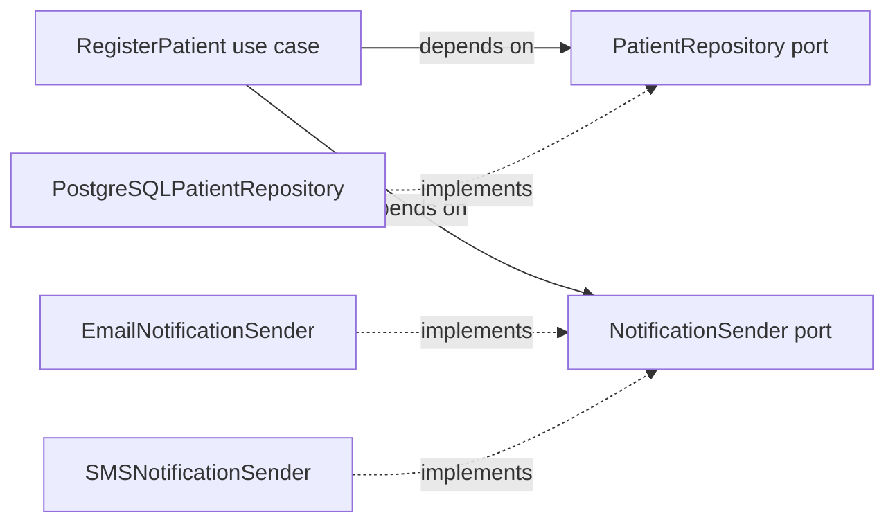

# SOLID Principles in Domain-Driven Design

## 1. Purpose

Step 11 established the four layers inside each bounded context. This document
defines how classes, interfaces, and services inside those layers should be
designed so the system stays testable and changeable as it grows.

Without design principles, clinic-system risks large classes with unrelated
responsibilities, business logic mixed with database code, hard-to-test use
cases, and changes that break unrelated functionality.

This is a design document. Code examples are illustrative; no production code
exists yet. They follow the vocabulary in
[`../domain/README.md`](../domain/README.md) and the layer boundaries in
[layered-architecture.md](layered-architecture.md).

## 2. Overview

| Letter | Principle | Main objective |
|---|---|---|
| S | Single Responsibility | One reason to change |
| O | Open/Closed | Extend without repeatedly modifying stable code |
| L | Liskov Substitution | Subtypes honor their contracts |
| I | Interface Segregation | Small, focused interfaces |
| D | Dependency Inversion | Depend on abstractions, not concrete technologies |

SOLID does not add layers or contexts. It shapes the components inside them.

## 3. S — Single Responsibility Principle

**Definition:** a class should have one reason to change. This does not mean one
method; it means one cohesive responsibility.

### Bad design

```python
class Patient:
    def __init__(self, patient_id, name):
        self.patient_id = patient_id
        self.name = name

    def validate(self):
        if not self.name:
            raise ValueError("Name required")

    def save_to_database(self):
        ...

    def send_registration_email(self):
        ...

    def generate_report(self):
        ...
```

`Patient` changes when registration rules, persistence, email, or reporting
changes. Four unrelated concerns share one class.

### Refactored design

```python
from typing import Protocol


class Patient:
    def __init__(self, patient_id: str, name: str) -> None:
        if not name:
            raise ValueError("Name required")
        self.patient_id = patient_id
        self.name = name


class PatientRepository(Protocol):
    def save(self, patient: Patient) -> None: ...


class PatientNotificationService:
    def send_registration_email(self, patient: Patient) -> None: ...


class PatientReportService:
    def generate(self, patient: Patient) -> object: ...
```

### Clinic examples

| Component | Responsibility |
|---|---|
| `Patient` | Patient business behavior |
| `PatientRepository` | Persistence contract or implementation |
| `RegisterPatient` | Registration workflow |
| `PatientReportService` | Report generation |
| `PatientNotificationService` | Notifications |

**When to use:** when a class accumulates unrelated responsibilities. Keep
cohesive methods together; do not split every method into its own class.

## 4. O — Open/Closed Principle

**Definition:** software entities should be open for extension but closed for
modification. New behavior should not require repeated edits to stable logic.

### Bad design

```python
class AppointmentPriceCalculator:
    def calculate(self, appointment_type: str) -> int:
        if appointment_type == "consultation":
            return 100
        if appointment_type == "follow_up":
            return 50
        if appointment_type == "specialist":
            return 150
        raise ValueError("Unsupported appointment type")
```

Every new appointment type modifies the calculator. The conditional grows with
each case. In our context map, service charges belong to Billing & Payments;
Appointment Management supplies the appointment type, not the price.

### Refactored design

```python
from decimal import Decimal
from typing import Protocol


class PricingPolicy(Protocol):
    def calculate(self) -> Decimal: ...


class ConsultationPricing:
    def calculate(self) -> Decimal:
        return Decimal("100")


class FollowUpPricing:
    def calculate(self) -> Decimal:
        return Decimal("50")


class SpecialistPricing:
    def calculate(self) -> Decimal:
        return Decimal("150")


class AppointmentPriceCalculator:
    def calculate(self, policy: PricingPolicy) -> Decimal:
        return policy.calculate()
```

A new policy can be added without editing the calculator. `Decimal` is used in
the example; Billing owns the `Money` value object described in
[bounded-contexts.md](bounded-contexts.md), so the production policy returns
`Money`, not an unrestricted integer.

**Clinic examples:** pricing policies, payment methods, invoice calculation
rules, notification channels.

**When to use:** at genuine extension points such as policies and strategies.
Do not introduce an abstraction for every possible future change.

## 5. L — Liskov Substitution Principle

**Definition:** a subtype must be usable wherever its parent type is expected,
without breaking the expected behavior. A child class honors the parent's
contract.

### Bad design

```python
class PaymentMethod:
    def pay(self, amount: int) -> None:
        raise NotImplementedError


class CashPayment(PaymentMethod):
    def pay(self, amount: int) -> None: ...


class CardPayment(PaymentMethod):
    def pay(self, amount: int) -> None: ...


class InsurancePayment(PaymentMethod):
    def pay(self, amount: int) -> None:
        raise NotImplementedError("Insurance cannot make direct payments")
```

`InsurancePayment` cannot honor `pay()`. Any caller that accepts a
`PaymentMethod` can receive an object that fails. The inheritance hierarchy
claims a behavior the subtype does not provide.

### Refactored design

```python
class PaymentProcessor(Protocol):
    def process(self, amount: Money) -> None: ...


class CashPaymentProcessor:
    def process(self, amount: Money) -> None: ...


class CardPaymentProcessor:
    def process(self, amount: Money) -> None: ...


class InsuranceClaimSubmission:
    def submit(self, invoice_id: str) -> None: ...
```

Direct payment and insurance claim submission are different business
operations. Both belong to Billing & Payments, but they no longer share a
misleading parent.

**Clinic examples:** payment processors, notification providers, repository
implementations, practitioner specializations that genuinely share a behavioral
contract.

**When to use:** whenever inheritance or polymorphism is used. A repository
implementation must satisfy `exists`, `save`, and `get_by_id` from
[layered-architecture.md](layered-architecture.md); it must not narrow or alter
that contract. Prefer composition and small `Protocol`s over deep inheritance.

## 6. I — Interface Segregation Principle

**Definition:** clients should not be forced to depend on methods they do not
use. Prefer several focused interfaces over one large interface.

### Bad design

```python
class ClinicRepository:
    def save_patient(self, patient): ...
    def get_patient(self, patient_id): ...
    def save_appointment(self, appointment): ...
    def get_appointment(self, appointment_id): ...
    def save_invoice(self, invoice): ...
    def process_payment(self, payment): ...
```

This interface mixes patient, appointment, invoice, and payment capabilities. A
registration use case would depend on operations it never calls, and the
boundary would cross bounded contexts.

### Refactored design

```python
from typing import Protocol
from uuid import UUID


class PatientRepository(Protocol):
    def exists(self, patient_id: UUID) -> bool: ...
    def save(self, patient: "Patient") -> None: ...
    def get_by_id(self, patient_id: UUID) -> "Patient | None": ...


class AppointmentRepository(Protocol):
    def save(self, appointment: "Appointment") -> None: ...
    def get_by_id(self, appointment_id: UUID) -> "Appointment | None": ...


class InvoiceRepository(Protocol):
    def save(self, invoice: "Invoice") -> None: ...
    def get_by_id(self, invoice_id: UUID) -> "Invoice | None": ...
```

Each application service depends only on the port it uses.

**Clinic examples:** `PatientRepository`, `AppointmentRepository`,
`EncounterRepository`, `InvoiceRepository`, `PaymentProcessor`, and
`NotificationSender`.

**When to use:** when an interface contains unrelated operations or clients
depend on functionality they never use.

## 7. D — Dependency Inversion Principle

**Definition:**

1. High-level modules should not depend on low-level modules; both should
   depend on abstractions.
2. Abstractions should not depend on details; details should depend on
   abstractions.

This is the principle that makes the dependency direction in Step 11 work.

### Bad design

```python
class RegisterPatient:
    def execute(self, patient: object) -> None:
        database = PostgreSQLDatabase()
        database.save(patient)
```

The use case creates its own database. Replacing PostgreSQL requires editing
application code, and unit tests must deal with a real database.

### Refactored design

```python
class RegisterPatient:
    def __init__(self, repository: PatientRepository) -> None:
        self.repository = repository

    def execute(self, patient: "Patient") -> None:
        self.repository.save(patient)


class PostgreSQLPatientRepository:
    def save(self, patient: "Patient") -> None: ...


repository = PostgreSQLPatientRepository()
use_case = RegisterPatient(repository)
use_case.execute(patient)
```

The use case and the repository implementation both depend on
`PatientRepository`. The abstraction belongs to the Domain Layer; the concrete
database class belongs to Infrastructure. The composition root injects the
implementation. See
[layered-architecture.md](layered-architecture.md) sections 4 and 5.

**Clinic examples:** `PatientRepository`, `AppointmentRepository`,
`InvoiceRepository`, `PaymentGateway`, and `EmailSender` abstractions.

**When to use:** whenever application or domain logic is coupled to a technical
implementation.

## 8. Comparison

| Principle | Bad design | Better design |
|---|---|---|
| SRP | One class handles everything | Separate cohesive responsibilities |
| OCP | Modify existing logic for every new case | Extend through policies |
| LSP | Child class breaks the parent contract | Honor behavioral contracts |
| ISP | One giant interface | Small, focused interfaces |
| DIP | Application directly creates the database | Inject an abstraction |

## 9. Placement in clinic-system

| Principle | Where it applies |
|---|---|
| SRP | Entities, value objects, use cases, repositories, and services |
| OCP | Pricing policies, payment strategies, notification channels |
| LSP | Repository implementations and external provider adapters |
| ISP | Focused repository and service ports |
| DIP | Application use cases depending on ports instead of infrastructure |

Product-facing decisions still follow context ownership. In particular, a
pricing policy is a Billing & Payments rule, notification delivery is an
Infrastructure implementation of an Application port, and no context imports
another context's domain model.

## 10. Patient Management design exercise

### 10.1 Requirements

The system must support registering, updating, retrieving, and searching
patients, and persisting patient information.

### 10.2 Component ownership

| Component | Responsibility | Principle |
|---|---|---|
| `Patient` | Patient business rules | SRP |
| `PatientName`, `DateOfBirth` | Name and date validation | SRP |
| `RegisterPatient` | Registration workflow | SRP |
| `PatientRepository` | Persistence contract | ISP, DIP |
| `PostgreSQLPatientRepository` | Database implementation | DIP, LSP |
| `PatientNotificationService` | Notifications | SRP, OCP |

### 10.3 Exercise 1 — identify violations

```python
class PatientService:
    def register_patient(self, patient: object) -> object:
        if not patient.name:
            raise ValueError("Name required")
        db = PostgreSQLDatabase()
        db.save(patient)
        email = EmailService()
        email.send(patient.email)
        return patient
```

| Problem | Principle | Why it matters |
|---|---|---|
| Validates, saves, and sends email in one method | SRP | Changes to any concern change this class |
| Creates `PostgreSQLDatabase` directly | DIP | Cannot swap storage or test without a database |
| Hard-codes `EmailService` | OCP | Adding SMS requires editing the method |
| No interface for collaborators | ISP, DIP | Tests cannot inject focused fakes |

The class is difficult to test because a unit test would need a working
database and an email provider. Separate it into a use case, domain rules, a
repository port, and a notification port.

### 10.4 Exercise 2 — design abstractions

```python
from dataclasses import dataclass
from datetime import date
from typing import Protocol
from uuid import UUID


@dataclass(frozen=True)
class RegisterPatientCommand:
    patient_id: UUID
    identity_number: str
    first_name: str
    last_name: str
    date_of_birth: date
    email: str


class NotificationSender(Protocol):
    def send(self, recipient: str, message: str) -> None: ...


class RegisterPatient:
    def __init__(
        self,
        repository: PatientRepository,
        notifications: NotificationSender,
    ) -> None:
        self.repository = repository
        self.notifications = notifications

    def execute(self, command: RegisterPatientCommand) -> "Patient":
        if self.repository.exists_by_identity(command.identity_number):
            raise DuplicatePatientIdentity(command.identity_number)
        patient = Patient.register(
            patient_id=command.patient_id,
            identity_number=command.identity_number,
            name=PatientName(
                first_name=command.first_name,
                last_name=command.last_name,
            ),
            date_of_birth=DateOfBirth(command.date_of_birth),
            email=command.email,
        )
        self.repository.save(patient)
        self.notifications.send(command.email, "Patient registered")
        return patient
```

The use case coordinates: check the registration identity, call domain behavior,
save through a port, and request a notification. The uniqueness rule and
name/date validation stay in the Domain Layer. `DuplicatePatientIdentity` is an
illustrative application exception; its exact vocabulary is fixed with the
domain implementation. Notification delivery is an Infrastructure detail behind
`NotificationSender`.

### 10.5 Exercise 3 — extension

```python
class EmailNotificationSender:
    def send(self, recipient: str, message: str) -> None: ...


class SMSNotificationSender:
    def send(self, recipient: str, message: str) -> None: ...
```

Both satisfy `NotificationSender`. Switching from email to SMS happens in the
composition root; `RegisterPatient` is unchanged.



Tests inject in-memory or mock implementations and run without PostgreSQL or an
email server. The ports stay small and belong to the inner layers.

## 11. How SOLID supports DDD

| DDD concept | SOLID support |
|---|---|
| Aggregate root | SRP keeps one root responsible for its own consistency |
| Value object | SRP puts each validation rule in one cohesive type |
| Domain service | SRP assigns cross-aggregate rules to a purpose-built service |
| Policy or strategy | OCP adds new rules without editing existing domain logic |
| Repository | ISP keeps the port focused; DIP keeps the model independent of storage |
| Domain event | SRP separates the recorded fact from its handlers |
| Bounded context | ISP blocks fat cross-context interfaces; LSP keeps contracts honest |

DDD decides *what* the model and its boundaries are. SOLID helps keep each
element of that model focused and replaceable.

## 12. How SOLID supports Clean Architecture

| Clean Architecture goal | SOLID mechanism |
|---|---|
| Dependencies point inward | DIP puts abstractions in inner layers and implementations outside |
| Use cases independent of frameworks | DIP and ISP: use cases depend only on narrow ports |
| Business rules testable in isolation | SRP: rules live in domain objects, not in services that open databases |
| Technology replaceable | OCP and LSP: new implementations satisfy existing ports |
| Stable inner layers | OCP: extension does not require editing stable application or domain code |

The composition root is the only place that chooses concrete implementations.
Inner layers never import FastAPI, SQLAlchemy, or a specific provider SDK. This
is the same dependency direction documented in
[layered-architecture.md](layered-architecture.md).

## 13. Guardrails

- Do not create an abstraction for every possible future change (OCP).
- Prefer composition and `Protocol` over deep inheritance (LSP).
- Let the consumer define the interface it needs (ISP).
- Do not split cohesive methods merely to reduce class size (SRP).
- Keep context ownership intact; SOLID never justifies a shared domain model or
  unrestricted money values.

## 14. Verification checklist

- [x] All five SOLID principles are defined.
- [x] Each principle has a bad design example and a refactored example.
- [x] Patient Management components have responsibilities and principles.
- [x] The `PatientService` violations and testing problems are explained.
- [x] Focused ports and interchangeable notification implementations are shown.
- [x] DDD and Clean Architecture support is documented.

## 15. Related documents

- [layered-architecture.md](layered-architecture.md) — layers, dependency
  direction, and repository port.
- [bounded-contexts.md](bounded-contexts.md) — context ownership and the `Money`
  value object.
- [context-map.md](context-map.md) — cross-context contracts and adapters.
- [`../domain/application-services.md`](../domain/application-services.md) —
  use-case coordination.
- [`../domain/aggregate-roots.md`](../domain/aggregate-roots.md) — aggregate
  responsibility and encapsulation.
