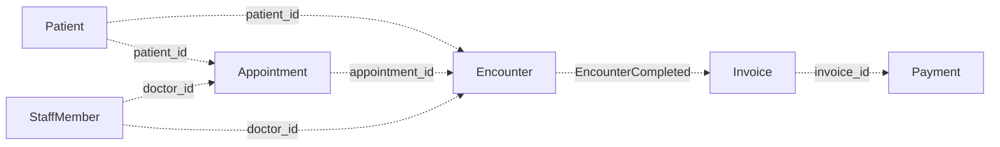

# Domain Modeling

## 1. Domain Model Overview

A domain model is a shared representation of the business concepts, rules, and
behaviors that `clinic-system` must support. It uses the ubiquitous language
from [glossary.md](glossary.md) and
[ubiquitous-language.md](ubiquitous-language.md), not framework or storage
terms.

This document consolidates the domain design recorded in
[domain-model.md](domain-model.md),
[entities.md](entities.md), [value-objects.md](value-objects.md),
[aggregates.md](aggregates.md), [aggregate-roots.md](aggregate-roots.md), and
[domain-invariants.md](domain-invariants.md). It describes design intent; no
production domain code exists yet.

| Context | Primary aggregate roots |
|---|---|
| Patient Management | `Patient` |
| Appointment Management | `Appointment` |
| Clinical Management | `Encounter` |
| Billing & Payments | `Invoice`, `Payment` |
| Staff Management (supporting) | `StaffMember` |

The four primary contexts are the authority for ownership; see
[`../architecture/bounded-contexts.md`](../architecture/bounded-contexts.md).
Staff Management remains an upstream context for practitioner identity and
availability.

Modeling principles:

- model behavior and invariants, not just fields;
- distinguish entities by identity and value objects by values;
- treat one aggregate as one consistency boundary;
- expose one aggregate root as the only entry point for state changes;
- reference other aggregates by identifier, never by object graph;
- keep cross-context facts in contracts and events, not shared domain classes;
- do not put FastAPI, SQLAlchemy, tables, or provider terminology in the model.

Known disagreements between earlier documents are recorded here rather than
silently resolved. They must be settled with domain experts before
implementation.

## 2. Entities

An entity is a concept the business tracks over time. It has an identity that
survives changes to its attributes.

| Classification rule | Result |
|---|---|
| Tracked over time and needs a unique identifier | Entity candidate |
| Values change while remaining the same concept | Entity |
| Meaningful only inside another aggregate | Local entity or value object |
| Defined only by values | Value object |

Aggregate roots are entities that can be loaded directly and changed from
outside their aggregate.

| Aggregate root | Identity | Lifecycle |
|---|---|---|
| `Patient` | `Patient ID` | Registered → Active → Deactivated |
| `Appointment` | `Appointment ID` | Scheduled → Confirmed → Completed / Cancelled / No-show |
| `Encounter` | `Encounter ID` | In progress → Completed |
| `StaffMember` | Staff ID / `Doctor ID` | Registered → Active → Deactivated |
| `Invoice` | `Invoice ID` | Draft → Issued → Paid / Overdue |
| `Payment` | `Payment ID` | Recorded → Refunded |

Local entities have identity only inside their root and are never loaded
independently.

| Local entity | Parent aggregate | Why it is an entity |
|---|---|---|
| `PatientContact` | `Patient` | Contact details have continuity inside the patient record |
| `ClinicalNote` | `Encounter` | Notes are recorded and amended while belonging to one encounter |
| `Diagnosis` | `Encounter` | Multiple diagnoses can be reviewed separately |
| `TreatmentPlan` | `Encounter` | Multiple planned interventions can be tracked |
| `InvoiceItem` | `Invoice` | Each charge must be individually identified and adjusted |

`Patient Record` is the `Patient` aggregate as a whole, not a second entity.
`Medical History` is a projection of clinical facts, not an entity owned by
`Patient`. `Appointment Schedule` is a read model. `Cancellation`,
`Rescheduling`, `Check-in`, and `No-show` are behaviors or outcomes, not
separate entities.

When entities are implemented, generate business identities explicitly, keep
state private, expose behavior methods, and reference other aggregates only by
identifier.

## 3. Value Objects

A value object is defined entirely by its values. It has no independent
identity: when a value changes, the object is replaced.

| Rule | Requirement |
|---|---|
| Identity | None |
| Equality | Compared by value |
| Mutability | Immutable after construction |
| Validation | In the constructor or factory |
| Lifecycle | Replace instead of changing |

| Value object | Attributes | Context or owner |
|---|---|---|
| `Patient ID`, `Appointment ID`, `Encounter ID` | Identifier value | Their aggregate roots |
| `PatientName`, `DateOfBirth` | Name parts, birth date | `Patient` |
| `ContactInformation`, `Address` | Phone, email, postal address | `Patient` |
| `MedicalRecordNumber` | Clinical identifier value | `Patient` contract |
| `TimeSlot` | Doctor ID, start, end | `Appointment` |
| `AppointmentStatus`, `AppointmentType` | Status or kind | `Appointment` |
| `EncounterStatus`, `ClinicalCode`, `Consultation` | State or clinical content | `Encounter` |
| `VitalSigns`, `BloodPressure`, `BodyTemperature` | Measurements and units | `Encounter` |
| `InvoiceStatus` | Draft, issued, paid, overdue | `Invoice` |
| `Money`, `Service Fee` | Amount and currency | Billing |
| `Outstanding Balance` | Derived money value | `Invoice`, `Payment`, `Refund` |

Illustrative definitions:

```python
from dataclasses import dataclass
from datetime import date, datetime
from decimal import Decimal


@dataclass(frozen=True)
class PatientName:
    first_name: str
    last_name: str

    def __post_init__(self) -> None:
        if not self.first_name.strip() or not self.last_name.strip():
            raise ValueError("patient name is required")


@dataclass(frozen=True)
class DateOfBirth:
    value: date

    def __post_init__(self) -> None:
        if self.value >= date.today():
            raise ValueError("date of birth must be in the past")


@dataclass(frozen=True)
class TimeSlot:
    doctor_id: str
    start: datetime
    end: datetime

    def __post_init__(self) -> None:
        if self.start >= self.end:
            raise ValueError("slot start must be before end")


@dataclass(frozen=True)
class Money:
    amount: Decimal
    currency: str

    def __post_init__(self) -> None:
        if self.amount < 0:
            raise ValueError("money amount cannot be negative")
```

`Money` replaces unrestricted integers. Arithmetic must not combine different
currencies. `Outstanding Balance` is derived as
`invoice total - payments + refunds` and is never edited directly.

Two vocabulary conflicts are tracked:

- [bounded-contexts.md](../architecture/bounded-contexts.md) uses
  `AppointmentPeriod`, while the current model calls the same idea `TimeSlot`;
- [value-objects.md](value-objects.md) treats contact details as
  `ContactInformation`, while [bounded-contexts.md](../architecture/bounded-contexts.md)
  lists `PatientContact` as an entity.

## 4. Aggregates and Aggregate Roots

An aggregate is a cluster of domain objects treated as one consistency
boundary. The aggregate root is the only entity external code may load and
modify.

| Aggregate root | Owning context | Inside the boundary |
|---|---|---|
| `Patient` | Patient Management | Identity, name, birth date, contact details |
| `Appointment` | Appointment Management | Identity, references, `TimeSlot`, status |
| `Encounter` | Clinical Management | Identity, references, notes, diagnoses, plan |
| `Invoice` | Billing & Payments | Identity, reference, items, total, status |
| `Payment` | Billing & Payments | Identity, invoice reference, amount, history |

```text
aggregate root
  |
  +-- local entities
  +-- value objects
  +-- identity references to other aggregate roots
  +-- recorded domain events
```

Rules:

1. The root checks invariants before changing state.
2. State changes happen through behavior methods.
3. Local entities are reached only through the root.
4. One repository loads and saves the root.
5. One transaction normally changes one aggregate.
6. Other aggregates are referenced by identifier.
7. Cross-context coordination belongs in application services and events.

Preferred and rejected styles:

```python
appointment.cancel()
appointment.status = "cancelled"
```

The second form bypasses transition checks. A later implementation must make
state private so it cannot be assigned from outside the root. Repositories load
and save roots; they do not modify aggregate internals.

See [aggregates.md](aggregates.md) and
[aggregate-roots.md](aggregate-roots.md) for the earlier Appointment-focused
definition.

## 5. Aggregate Invariants

An invariant is a business condition that must hold inside an aggregate. A
construction rule prevents an invalid aggregate from existing; a transition
rule prevents a valid aggregate from becoming invalid.

| Aggregate | Invariant | Enforced by |
|---|---|---|
| `Patient` | Unique patient identifier | `Patient.register(...)` |
| `Patient` | Valid name and date of birth | `PatientName`, `DateOfBirth` |
| `Patient` | Required registration details present | `Patient.register(...)` |
| `Patient` | Patient is not silently deleted | `Patient.deactivate()` |
| `Appointment` | Valid time slot | `TimeSlot` |
| `Appointment` | Patient ID and doctor ID present | `Appointment.book(...)` |
| `Appointment` | Cancelled appointment cannot be checked in | `Appointment.check_in()` |
| `Appointment` | Completed appointment cannot be cancelled | `Appointment.cancel()` |
| `Appointment` | Only confirmed appointments can be checked in | `Appointment.check_in()` |
| `Appointment` | Only checked-in appointments can be completed | `Appointment.complete()` |
| `Encounter` | One patient and one doctor | `Encounter.start(...)` |
| `Encounter` | Status transitions are valid | `Encounter` behavior methods |
| `Encounter` | Completion has required documentation | `Encounter.complete()` |
| `Encounter` | Notes preserve correction history | `ClinicalNote.amend(...)` |
| `Invoice` | At least one billable item | `Invoice.issue()` |
| `Invoice` | Total equals the sum of items | `Invoice.add_item(...)` |
| `Invoice` | Money currencies are consistent | `Money` operations |
| `Invoice` | Payment cannot exceed outstanding balance without policy | Application service |
| `Invoice` | Refund retains transaction history | `Payment.refund(...)` |

The Appointment rules match INV-01 to INV-07 in
[domain-invariants.md](domain-invariants.md). A rejected operation raises a
domain exception and leaves the aggregate unchanged.

Rules involving other aggregates are not embedded in the root:

| Rule | Owner |
|---|---|
| Appointment references an existing patient and doctor | Application service resolves identifiers |
| Doctor has no conflicting appointment | Appointment availability service |
| Only authorized users cancel or update records | Application and authorization layer |
| Change is persisted atomically | Database transaction within one context |

## 6. Patient Aggregate

The `Patient` aggregate is the authoritative registration record in Patient
Management. A patient remains the same entity when contact details change.

| Element | Classification |
|---|---|
| `Patient` | Aggregate root |
| `Patient ID` | Identity value object |
| `PatientName`, `DateOfBirth` | Value objects |
| `ContactInformation`, `Address` | Value objects |
| `PatientContact` | Local entity candidate; reconciliation needed |
| `MedicalRecordNumber` | Identifier from a clinical integration contract |

Illustrative behavior:

```python
class Patient:
    @classmethod
    def register(
        cls,
        patient_id: str,
        name: PatientName,
        date_of_birth: DateOfBirth,
    ) -> "Patient":
        return cls(patient_id, name, date_of_birth)

    def update_contact_information(self, contact: object) -> None:
        self.contact_information = contact

    def deactivate(self) -> None:
        self.active = False
```

| Behavior | Rule |
|---|---|
| `register(...)` | Identity and required registration data must be valid |
| `update_contact_information(...)` | New values must pass value-object validation |
| `deactivate()` | Historical references remain valid |
| `update_demographics(...)` | Authorized change only; no silent deletion |

`Patient` does **not** own appointments, encounters, diagnoses, prescriptions,
invoices, payments, or insurance claim state. Appointment and encounter history
is referenced by `patient_id`. `Medical History` is a projection from clinical
records, not editable patient data.

The local-entity status of `PatientContact` is a conflict between earlier
documents. Do not implement both `PatientContact` and `ContactInformation` as
competing owners of the same data.

## 7. Appointment Aggregate

The `Appointment` aggregate owns a reserved period and its scheduling
lifecycle. It references a patient and a doctor by identifier.

| Element | Classification |
|---|---|
| `Appointment` | Aggregate root |
| `Appointment ID` | Identity value object |
| `patient_id`, `doctor_id` | Identity references, not object graphs |
| `TimeSlot` | Value object describing the reserved interval |
| `AppointmentStatus` | Lifecycle value object |
| `AppointmentType` | Kind of appointment |
| `AppointmentParticipant` | Candidate from context ownership; not in the initial aggregate |

The current model has no local entities inside `Appointment`. If
`AppointmentParticipant` is needed, add it only with a clear invariant that
requires it.

Creation follows the established service contract:

```python
appointment = Appointment.book(
    appointment_id=appointment_id,
    patient_id=patient_id,
    doctor_id=doctor_id,
    time_slot=time_slot,
)
```

`AppointmentType` is a value object carried by the command; the current
`book(...)` sketch does not yet accept it. Add it only when the model decision
is settled.

| Operation | Allowed from | Result |
|---|---|---|
| `confirm()` | `SCHEDULED` | `CONFIRMED` |
| `cancel()` | `SCHEDULED`, `CONFIRMED` | `CANCELLED` |
| `check_in()` | `CONFIRMED` | `CHECKED_IN` |
| `complete()` | `CHECKED_IN` | `COMPLETED` |
| `reschedule(...)` | Active, non-terminal state | New validated `TimeSlot` |
| `mark_no_show()` | Active appointment after the scheduled time | `NO_SHOW` |

The Stage 1 lifecycle in [appointment-lifecycle.md](appointment-lifecycle.md)
adds `CHECKED_IN`. Earlier documents allow `CONFIRMED → COMPLETED` directly and
also include `NO_SHOW`; see section 7 of
[domain-invariants.md](domain-invariants.md). Do not implement both transition
sets. Use [appointment-lifecycle.md](appointment-lifecycle.md) as the working
contract until domain experts decide.

Availability and conflict checks are coordinated outside the root by the
domain service in [domain-services.md](domain-services.md). The root enforces
its own state rules.

## 8. Encounter Aggregate

The `Encounter` aggregate owns clinical records created while care is
delivered. It is created when care begins, never when an appointment is booked.
It may reference an appointment by `appointment_id`, but the two aggregates
have separate identities and lifecycles.

| Element | Classification |
|---|---|
| `Encounter` | Aggregate root |
| `Encounter ID` | Identity value object |
| `patient_id`, `doctor_id` | Identity references |
| `appointment_id` | Optional identity reference |
| `ClinicalNote`, `Diagnosis`, `TreatmentPlan` | Local entities |
| `VitalSigns`, `ClinicalCode`, `Consultation` | Value objects |
| `EncounterStatus` | Lifecycle value object |

Illustrative usage:

```python
encounter = Encounter.start(
    encounter_id=encounter_id,
    patient_id=patient_id,
    doctor_id=doctor_id,
    appointment_id=appointment_id,
)
encounter.record_clinical_note(note)
encounter.record_diagnosis(diagnosis)
encounter.record_vital_signs(vital_signs)
encounter.define_treatment_plan(plan)
encounter.complete()
```

| Behavior | Rule |
|---|---|
| `start(...)` | One patient and one doctor are required |
| `record_clinical_note(...)` | Note has content, author, and timestamp |
| `amend_note(...)` | Original note content remains in history |
| `record_diagnosis(...)` | Diagnosis code is valid for its code system |
| `record_vital_signs(...)` | Measurements and units are valid |
| `define_treatment_plan(...)` | Plan stays inside the encounter |
| `complete()` | Required documentation is present |

Completion publishes `EncounterCompleted` with billable-service facts for
Billing; see [domain-events.md](domain-events.md). Clinical Management does not
create invoices or change appointment status.

`Prescription` remains a conflict: [domain-model.md](domain-model.md) places it
in a future Medication context, while
[bounded-contexts.md](../architecture/bounded-contexts.md) assigns medication
requests to Clinical Management. Resolve ownership before implementation.

## 9. Invoice Aggregate

The `Invoice` aggregate owns a request for payment in Billing & Payments. It
contains billable items and a calculated total. `Payment` is a separate
aggregate root because money received has its own identity, lifecycle, and
transaction history.

| Element | Classification |
|---|---|
| `Invoice` | Aggregate root |
| `Invoice ID` | Identity value object |
| `patient_id` | Identity reference |
| `InvoiceItem` | Local entity |
| `Money`, `Service Fee` | Value objects |
| `InvoiceStatus` | Lifecycle value object |
| `Outstanding Balance` | Derived value |
| `Payment` | Separate aggregate root in the same context |

Illustrative usage:

```python
invoice = Invoice.create(invoice_id=invoice_id, patient_id=patient_id)
invoice.add_item(
    service="consultation",
    fee=Money(amount=Decimal("100.00"), currency="USD"),
)
invoice.issue()
```

| Behavior | Rule |
|---|---|
| `add_item(...)` | Item has a service and `Money` fee |
| `recalculate_total()` | Total equals the sum of items in one currency |
| `issue()` | At least one billable item exists |
| `mark_settled()` | Outstanding balance is zero |
| `allocate_payment(...)` | Payment references this invoice and respects policy |

`Outstanding Balance` is derived from invoice total, payments, and refunds:

```text
outstanding = invoice total - payments + refunds
```

It is not edited directly. A payment cannot exceed the outstanding balance
unless an explicit overpayment policy exists. A refund retains the payment's
transaction history.

`InvoiceStatus` values currently come from
[bounded-contexts.md](../architecture/bounded-contexts.md):
`DRAFT`, `ISSUED`, `PAID`, and `OVERDUE`.
[entities.md](entities.md) also mentions partially paid and refunded states.
Confirm the final status set before implementation.

## 10. Aggregate Relationships

Aggregates reference each other by identity. They do not hold each other's
object graphs, and no aggregate changes another aggregate's state.



| Relationship | Rule |
|---|---|
| `Patient → Appointment` | Appointment stores `patient_id`; registration data stays in Patient Management |
| `Patient → Encounter` | Encounter stores `patient_id`; no clinical data in the patient aggregate |
| `Appointment → Encounter` | Optional `appointment_id`; separate lifecycles |
| `Encounter → Invoice` | Billable facts cross by `EncounterCompleted`, not direct mutation |
| `Invoice → Payment` | Payment stores `invoice_id`; both are roots in the same context |
| `StaffMember → Appointment` | Appointment stores `doctor_id`; availability stays upstream |
| `StaffMember → Encounter` | Encounter stores `doctor_id`; employment data stays upstream |

Cross-context rules:

- Code in one context does not import another context's domain classes.
- Code in one context does not read or write another context's tables directly.
- A shared database is allowed, but shared ownership is not.
- Events use the published contracts in
  [context-map.md](../architecture/context-map.md).
- A local copy of another context's fact becomes part of the local model.
- Cross-context workflows use eventual consistency, not one distributed
  transaction.

Verification checklist:

- [ ] Every aggregate has one owning context.
- [ ] Every relationship is an identifier, event, or explicit integration
      contract.
- [ ] Every invariant has a named owner and a failing test.
- [ ] Rejected behavior leaves the aggregate unchanged.
- [ ] Known conflicts with earlier documents remain visible until resolved.
