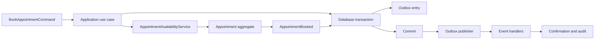

# Domain Services, Events & Repository Design

## 1. Domain Services

A Domain Service contains business logic that does not naturally belong to one
Entity or Value Object. It answers the question **what does the business
allow?** It does not coordinate a whole use case, build HTTP responses, open
transactions, or call an email provider.

| Operation | Appropriate location |
|---|---|
| Cancel an appointment | `Appointment` aggregate root |
| Reschedule an appointment | `Appointment` aggregate root |
| Calculate an invoice total | `Invoice` aggregate root |
| Check whether a doctor is free at a time | `AppointmentAvailabilityService` |
| Decide whether a patient is eligible for a booking | Domain Service, once the rule is confirmed |
| Send a confirmation notice | Application or infrastructure handler |

For `clinic-system`, the accepted Domain Service is
`AppointmentAvailabilityService` in
[domain-services.md](domain-services.md). Some material calls the same idea
`AppointmentSchedulingService.is_available(...)`; our contract uses
`ensure_available(doctor_id, time_slot)` and raises `DomainException` when the
rule is violated. That keeps one business outcome instead of a boolean that the
caller could reinterpret.

```python
from uuid import UUID

from clinic_system.domain.exceptions.domain_exception import DomainException
from clinic_system.domain.repositories.appointment_repository import (
    AppointmentRepository,
)
from clinic_system.domain.value_objects.time_slot import TimeSlot


class AppointmentAvailabilityService:
    def __init__(self, repository: AppointmentRepository) -> None:
        self.repository = repository

    def ensure_available(
        self,
        doctor_id: UUID,
        time_slot: TimeSlot,
    ) -> None:
        conflict = self.repository.has_conflicting_appointment(
            doctor_id=doctor_id,
            time_slot=time_slot,
        )
        if conflict:
            raise DomainException(
                "Doctor is not available during this time slot"
            )
```

Two intervals overlap when both conditions hold:

```text
existing.start < requested.end
AND existing.end > requested.start
```

| Existing appointment | Requested appointment | Result |
|---|---|---|
| 09:00–09:30 | 09:15–09:45 | Conflict |
| 09:00–09:30 | 09:30–10:00 | Available |
| 09:00–09:30 | 10:00–10:30 | Available |

The service belongs in the Domain Layer:

```text
appointment_management/
├── domain/
│   ├── entities/appointment.py
│   ├── value_objects/time_slot.py
│   ├── services/appointment_availability.py
│   ├── events/appointment_booked.py
│   └── repositories/appointment_repository.py
├── application/
├── infrastructure/
└── presentation/
```

It must not import FastAPI, SQLAlchemy, PostgreSQL drivers, HTTP request
objects, or provider SDKs. The repository query is supplied through a domain
protocol; the service makes one availability check and performs no writes.

## 2. Domain Events

A Domain Event is an immutable statement of a completed business occurrence.
Names use the past tense: `AppointmentBooked`, not `BookAppointment`.

| Command | Event |
|---|---|
| `BookAppointmentCommand` | `AppointmentBooked` |
| `CancelAppointmentCommand` | `AppointmentCancelled` |
| `CompleteEncounterCommand` | `EncounterCompleted` |
| `IssueInvoiceCommand` | `InvoiceIssued` |
| `RecordPaymentCommand` | `PaymentReceived` |

A command can fail. An event records a fact that already succeeded. The current
scope implements `AppointmentBooked`; the other names are vocabulary for later
work. See [domain-events.md](domain-events.md).

The established event contract carries identities and a timestamp, not the
whole aggregate:

```python
from dataclasses import dataclass
from datetime import datetime, timezone
from uuid import UUID


@dataclass(frozen=True)
class AppointmentBooked:
    appointment_id: UUID
    patient_id: UUID
    doctor_id: UUID
    occurred_at: datetime

    @classmethod
    def create(
        cls,
        appointment_id: UUID,
        patient_id: UUID,
        doctor_id: UUID,
    ) -> "AppointmentBooked":
        return cls(
            appointment_id=appointment_id,
            patient_id=patient_id,
            doctor_id=doctor_id,
            occurred_at=datetime.now(timezone.utc),
        )
```

An `event_id` may be added later for outbox deduplication; it is not part of
the current contract. The aggregate records the event when booking succeeds:

```python
@classmethod
def book(
    cls,
    appointment_id: UUID,
    patient_id: UUID,
    doctor_id: UUID,
    time_slot: TimeSlot,
) -> "Appointment":
    appointment = cls(
        id=appointment_id,
        patient_id=patient_id,
        doctor_id=doctor_id,
        time_slot=time_slot,
    )
    appointment._events.append(
        AppointmentBooked.create(
            appointment_id=appointment.id,
            patient_id=appointment.patient_id,
            doctor_id=appointment.doctor_id,
        )
    )
    return appointment

def collect_events(self) -> list[object]:
    events = list(self._events)
    self._events.clear()
    return events
```

The aggregate records the fact; it does not send notices or call external APIs.
`collect_events()` gives the Application Layer access to events. Clearing the
collection prevents duplicate dispatch from the same instance. With an outbox,
events must be persisted before they are considered delivered; see section 8.

## 3. Event Handlers

An Event Handler reacts to a fact after it has happened. Handlers live in the
Application or Infrastructure Layer, not in the domain.

```python
class AppointmentConfirmationHandler:
    def handle(self, event: AppointmentBooked) -> None:
        self.notifications.send_booking_confirmation(
            appointment_id=event.appointment_id,
            patient_id=event.patient_id,
        )


class AppointmentAuditHandler:
    def handle(self, event: AppointmentBooked) -> None:
        self.audit.record(
            event_type=type(event).__name__,
            occurred_at=event.occurred_at,
            subject_id=event.appointment_id,
        )
```

The Application Layer depends on a narrow dispatcher port:

```python
from typing import Protocol


class EventDispatcher(Protocol):
    def dispatch(self, event: object) -> None: ...
```

```text
BookAppointmentCommand
        |
        v
Application use case
        |
        v
Appointment aggregate records AppointmentBooked
        |
        v
repository.save()
        |
        v
collect_events()
        |
        v
EventDispatcher.dispatch()
        |
        +--> AppointmentConfirmationHandler
        |
        +--> AppointmentAuditHandler
```

Both handlers respond independently. Adding a third handler does not change the
aggregate or the use case. Our initial modular monolith dispatches in-process;
this does not imply Kafka, RabbitMQ, or microservices. Delivery may be retried,
so handlers must be idempotent.

## 4. Repository Pattern

A Repository provides collection-like access to Aggregates. The caller asks for
an aggregate by identity and saves it again without knowing whether storage is
PostgreSQL, SQLite, a file, or memory.

```python
appointment = appointment_repository.get_by_id(appointment_id)
appointment_repository.save(appointment)
```

Direct database access inside a service creates the wrong dependency:

```python
class AppointmentService:
    def __init__(self, session: object) -> None:
        self.session = session
```

Here business logic would depend on a concrete session and ORM model. Instead,
the Application and Domain layers depend on a protocol, and Infrastructure
implements it.

| Aggregate root | Repository |
|---|---|
| `Patient` | `PatientRepository` |
| `Appointment` | `AppointmentRepository` |
| `Encounter` | `EncounterRepository` |
| `Invoice` | `InvoiceRepository` |
| `Payment` | `PaymentRepository` |

Repositories are designed around Aggregate Roots, not tables or every Entity.
There is no `InvoiceItemRepository`: the `InvoiceRepository` loads and saves the
whole `Invoice` aggregate. Local entities such as `ClinicalNote` and `Diagnosis`
are reached through their root.

Dependency direction:

```text
Application Layer --> Repository protocol (inner abstraction)
Infrastructure Layer --> Repository protocol (implementation)
```

This is Dependency Inversion: concrete persistence depends on the contract,
not the other way around.

## 5. Repository Interfaces

Python `Protocol` defines the persistence contract without tying it to a
framework. The current booking flow uses `has_conflicting_appointment(...)` and
`save(...)`; the fuller collection interface adds identity lookup and queries.

```python
from typing import Protocol
from uuid import UUID

from clinic_system.domain.entities.appointment import Appointment
from clinic_system.domain.value_objects.appointment_status import (
    AppointmentStatus,
)
from clinic_system.domain.value_objects.time_slot import TimeSlot


class AppointmentRepository(Protocol):
    def get_by_id(
        self,
        appointment_id: UUID,
    ) -> Appointment | None: ...

    def save(self, appointment: Appointment) -> None: ...

    def has_conflicting_appointment(
        self,
        doctor_id: UUID,
        time_slot: TimeSlot,
    ) -> bool: ...

    def get_by_doctor(self, doctor_id: UUID) -> list[Appointment]: ...
```

Requirements say `practitioner`, but code contracts use `doctor_id`, following
the ubiquitous-language decision recorded in
[bounded-contexts.md](../architecture/bounded-contexts.md).

A simplified in-memory implementation:

```python
class InMemoryAppointmentRepository:
    def __init__(self) -> None:
        self._appointments: dict[UUID, Appointment] = {}

    def get_by_id(self, appointment_id: UUID) -> Appointment | None:
        return self._appointments.get(appointment_id)

    def save(self, appointment: Appointment) -> None:
        self._appointments[appointment.id] = appointment

    def has_conflicting_appointment(
        self,
        doctor_id: UUID,
        time_slot: TimeSlot,
    ) -> bool:
        return any(
            appointment.doctor_id == doctor_id
            and appointment.status != AppointmentStatus.CANCELLED
            and appointment.time_slot.start < time_slot.end
            and time_slot.start < appointment.time_slot.end
            for appointment in self._appointments.values()
        )

    def get_by_doctor(self, doctor_id: UUID) -> list[Appointment]:
        return [
            appointment
            for appointment in self._appointments.values()
            if appointment.doctor_id == doctor_id
        ]
```

A `PostgresAppointmentRepository` can later satisfy the same protocol. Tests
use the in-memory version without PostgreSQL. The domain port itself belongs to
the inner layer; only implementations use SQLAlchemy.

## 6. Unit of Work

A Unit of Work coordinates which changes commit together. A Repository answers
which aggregates are accessed; a Unit of Work answers which changes must
succeed or fail as one transaction.

```python
from typing import Protocol


class UnitOfWork(Protocol):
    appointments: AppointmentRepository

    def commit(self) -> None: ...

    def rollback(self) -> None: ...
```

A context manager can express transaction scope:

```python
class InMemoryUnitOfWork:
    def __init__(self, appointments: AppointmentRepository) -> None:
        self.appointments = appointments

    def __enter__(self) -> "InMemoryUnitOfWork":
        return self

    def __exit__(
        self,
        exc_type: object,
        exc_value: object,
        traceback: object,
    ) -> None:
        if exc_type is not None:
            self.rollback()
        else:
            self.commit()

    def commit(self) -> None:
        pass

    def rollback(self) -> None:
        pass
```

This is structural only: the in-memory version does not provide real rollback.
A database-backed Unit of Work must share one session across its repositories
and make `commit()` and `rollback()` meaningful.

| Repository | Unit of Work |
|---|---|
| Loads and saves aggregates | Coordinates the transaction |
| Provides collection-like access | Commits changes |
| Focuses on persistence access | Rolls back failed work |

A Unit of Work stays inside one bounded context. It must not span an external
API, a message broker, or another context's aggregates.

## 7. Transaction Boundaries

The current illustrative flow is save, then dispatch:

```text
Appointment.book()          -> records AppointmentBooked
repository.save()           -> persists the aggregate
collect_events()            -> reads and clears recorded events
EventDispatcher.dispatch()  -> delivers to interested handlers
```

This is simple and correct for a single process. It has two known production
risks:

1. **Dual-write problem:** the process crashes after the save but before
   dispatch. The appointment exists and the event is lost.
2. **Concurrent booking:** two requests can both pass the availability check
   before either saves. Database constraints, locking, or serialization are
   needed later.

Other rules stay outside the aggregate:

| Concern | Owner |
|---|---|
| Patient identity and active status | Application Layer using a Patient Management contract |
| Doctor identity | Application Layer resolves the identifier |
| Slot availability | `AppointmentAvailabilityService` |
| Atomic persistence of the appointment | Repository and Unit of Work |
| Event delivery | Dispatcher, later an Outbox publisher |

The existing `BookAppointmentService` in
[application-services.md](application-services.md) assumes identifiers have
already been resolved. Checking that a patient exists and is active is a
cross-context application step, not a method on `Appointment`.

## 8. Outbox Pattern

The Outbox Pattern stores the event in the same database transaction as the
aggregate. A publisher reads pending entries after commit and delivers them.



An outbox entry needs at least an event type, serialized payload, occurrence
time, delivery status, retry count, and published time. Serialization belongs
in Infrastructure; the domain event remains a plain immutable object.

Delivery rules:

- handlers may receive the same event more than once;
- handlers must be idempotent;
- the publisher marks entries published only after successful delivery;
- retries need a bounded policy and failure recording;
- event schemas need versioning when consumers depend on them.

With an outbox, event collection must not clear the recorded events before they
are durably written. The safe order is: save aggregate, save outbox entry,
commit, then hand events to the publisher. This is future work; no broker or
outbox table is needed for the current stage.

See [domain-events.md](domain-events.md) for the earlier outbox decision.

## 9. Appointment Booking Flow

Putting the pieces together:

```text
Command:              BookAppointmentCommand
Application use case: BookAppointmentService.execute()
Domain Service:       AppointmentAvailabilityService.ensure_available()
Domain objects:       Appointment, TimeSlot, AppointmentBooked
Persistence:          AppointmentRepository, UnitOfWork
Event processing:     EventDispatcher, confirmation and audit handlers
```

Current illustrative sequence:

1. Build `TimeSlot` from the command.
2. Resolve patient and doctor identifiers before creation.
3. Call `ensure_available(doctor_id, time_slot)`.
4. Create the aggregate with `Appointment.book(...)`.
5. Save it through `AppointmentRepository.save(...)`.
6. Read recorded events with `collect_events()`.
7. Dispatch each event through `EventDispatcher.dispatch(...)`.
8. Return the aggregate to the caller.

Target sequence once Unit of Work and Outbox are implemented:

1. Begin a transaction within Appointment Management.
2. Resolve the patient identity fact from Patient Management.
3. Check slot availability and conflicts.
4. Create the aggregate and record `AppointmentBooked`.
5. Save the aggregate.
6. Save the serialized event to the outbox.
7. Commit.
8. Publish and handle the event, with idempotent handlers.

Failure handling remains explicit: an invalid slot fails before repository or
dispatcher calls; a conflict raises `DomainException`; a failed save dispatches
no event. After a commit, delivery reliability belongs to the outbox.

## 10. Design Decisions

| Decision | Choice | Reason |
|---|---|---|
| Availability rule owner | `AppointmentAvailabilityService` | It compares one request against many appointments |
| Service operation | `ensure_available(doctor_id, time_slot)` | One business outcome; raises `DomainException` |
| Boolean `is_available(...)` | Not adopted as the primary contract | Callers could reinterpret a boolean incorrectly |
| `practitioner_id` in code | Rejected in favor of `doctor_id` | Matches the ubiquitous-language decision |
| Domain Service location | Domain Layer | The rule is business logic, not orchestration |
| HTTP, ORM, and SDK imports | Prohibited in domain services | Keeps business rules testable and technology-independent |
| Event contract | `AppointmentBooked` with identities and `occurred_at` | A fact, not a command or database row |
| `event_id` | Deferred | Add with outbox and deduplication support |
| Aggregate event recording | `book()` appends the event | The fact is created with the state change |
| `collect_events()` | Reads and clears events | Prevents duplicate dispatch from one instance |
| Dispatcher | `EventDispatcher.dispatch(...)` port | In-process now; replaceable later |
| Brokers or microservices | Deferred | No current deployment requirement |
| Notification sending | Application or infrastructure handler | Entities do not send emails |
| Repository scope | Aggregate Roots only | Avoids per-table repositories and leaked persistence models |
| Repository contract | `Protocol` in the inner layer | Dependency Inversion; infrastructure implements it |
| In-memory implementations | Accepted for tests | Fast, no PostgreSQL dependency |
| Unit of Work | Within one context only | No distributed transaction across contexts or external APIs |
| Outbox Pattern | Adopted as future production direction | Solves the save/dispatch dual-write problem |
| Empty package scaffolding | Avoided | Create folders when real code needs them |

Verification checklist:

- [ ] Business rules that span appointments live in a Domain Service.
- [ ] Domain Services contain no HTTP, ORM, transaction, or provider code.
- [ ] Events are immutable, past tense, and dispatched after a successful save.
- [ ] Handlers are independent and idempotent.
- [ ] Repositories are per Aggregate Root and expose collection-like access.
- [ ] Repository protocols are owned by inner layers.
- [ ] Unit of Work does not span contexts or external systems.
- [ ] The dual-write risk and outbox direction are documented.
