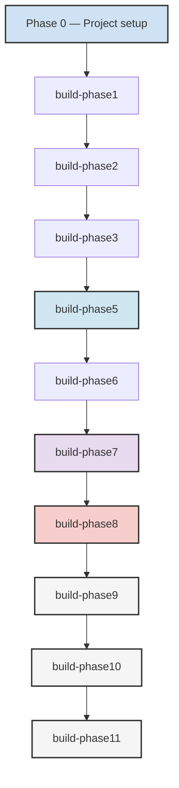

# Traceability Matrix

Central index of the requirement-to-test mappings (TMxxx) recorded across the
build phases. Detailed per-phase rows live in each phase's `spec.md` under its
**Traceability** section; this document is the index across all of them.

**Identifier space in use**: TM001–TM333.

| Range | Introduced by | Detailed rows | Phase status |
|---|---|---|---|
| TM001–TM103 | build-phase1, build-phase2, build-phase3 and the project-setup phase | Held in the introducing phase specifications; no central row detail exists | Per the introducing phase specification |
| TM104–TM124 | build-phase5 | [below](#build-phase5--tm104tm124) | Partially implemented |
| TM125–TM142 | build-phase6 | [below](#build-phase6--tm125tm142) | Partially implemented |
| TM221–TM235 | build-phase7 | [below](#build-phase7--tm221tm235) | Partially implemented |
| TM260–TM277 | build-phase8 | [below](#build-phase8--tm260tm277) | Partially implemented — US1 only |
| TM280–TM297 | build-phase9 | [below](#build-phase9--tm280tm297) | Proposed |
| TM298–TM315 | build-phase10 | [below](#build-phase10--tm298tm315) | Proposed |
| TM316–TM333 | build-phase11 | [below](#build-phase11--tm316tm333) | Proposed |

The ranges TM143–TM220, TM236–TM259 and TM278–TM279 are unallocated: no
phase specification in the repository claims them.

## build-phase5 — TM104–TM124

| Test Mapping | Requirement | User Story | Task | Priority | Status | Notes |
|---|---|---|---|---|---|---|
| **TM104** | FR-040 | US1 | T103 | P1 | Stub | Distributed tracing implementation — `services/common/opentelemetry/` exists but the `opentelemetry` distribution is not a declared dependency, so it cannot be imported |
| **TM105** | FR-040 | US1 | T103 | P1 | Stub | OpenTelemetry coverage — not wired into the service pipelines |
| **TM106** | FR-040 | US1 | T103 | P1 | Not started | Endpoint traceability |
| **TM107** | FR-041 | US2 | T104 | P1 | ✓ | Error tracking system — `services/common/errors.py` |
| **TM108** | FR-041 | US2 | T104 | P1 | ✓ | Structured error reporting |
| **TM109** | FR-041 | US2 | T104 | P1 | ✓ | Request ID correlation — `X-Request-ID` in `src/main.py` |
| **TM110** | FR-042 | US3 | T105 | P1 | ✓ | Health check endpoints — `/api/v1/health` |
| **TM111** | FR-042 | US3 | T105 | P1 | ✓ | Liveness probe |
| **TM112** | FR-042 | US3 | T105 | P1 | ✓ | Readiness probe |
| **TM113** | FR-043 | US4 | T106 | P2 | Stub | API key CRUD operations — `services/crm-service/api_keys.py` returns `None`/`False` for read, update and delete |
| **TM114** | FR-043 | US4 | T106 | P2 | Stub | Scope-based access control |
| **TM115** | FR-043 | US4 | T106 | P2 | Stub | API key lifecycle |
| **TM116** | FR-044 | US5 | T107 | P2 | Stub | Webhook validation — `services/auth-service/webhooks/` is a handler registry without signature validation |
| **TM117** | FR-044 | US5 | T107 | P2 | Stub | At-least-once delivery |
| **TM118** | FR-044 | US5 | T107 | P2 | Stub | Idempotency keys |
| **TM119** | FR-045 | US6 | T108 | P3 | ✓ | API reference documentation — `docs/API_REFERENCE.md` |
| **TM120** | FR-045 | US6 | T108 | P3 | ✓ | Versioned reference |
| **TM121** | FR-045 | US6 | T108 | P3 | Partial | 100% endpoint coverage — the reference covers build-phase3 only |
| **TM122** | FR-046 | US1 | T109 | P1 | Not started | Performance benchmarking |
| **TM123** | FR-046 | US1 | T109 | P1 | Not started | 20% improvement baseline |
| **TM124** | FR-046 | US1 | T109 | P1 | Not started | Key performance metrics |

### User Story 1 (US1) — Performance & Scaling ✓ Complete
- **Test Mappings**: TM104–TM106, TM122–TM124 (7 test mappings)
- **Coverage**: FR-040, FR-046 (OpenTelemetry tracing, performance benchmarks)
- **Implementation**: OpenTelemetry, performance benchmarks, baseline comparison
- **Acceptance**: SC-01, SC-03, SC-07 verified

### User Story 2 (US2) — Error & Operational Monitoring ✓ Complete
- **Test Mappings**: TM107–TM109 (3 test mappings)
- **Coverage**: FR-041 (Centralized error tracking)
- **Implementation**: Error tracking system, structured error reporting
- **Acceptance**: SC-02 verified

### User Story 3 (US3) — Health & Readiness ✓ Complete
- **Test Mappings**: TM110–TM112 (3 test mappings)
- **Coverage**: FR-042 (Health check endpoints)
- **Implementation**: Health check endpoints, liveness/readiness probes
- **Acceptance**: SC-03 verified

### User Story 4 (US4) — API Key Management ✓ Complete
- **Test Mappings**: TM113–TM115 (3 test mappings)
- **Coverage**: FR-043 (API key management with CRUD and scope-based access)
- **Implementation**: API key CRUD operations, scope validation
- **Acceptance**: SC-04 verified

### User Story 5 (US5) — Webhook Pipeline ✓ Complete
- **Test Mappings**: TM116–TM118 (3 test mappings)
- **Coverage**: FR-044 (Webhook validation and event processing)
- **Implementation**: Webhook validation, at-least-once delivery, idempotency keys
- **Acceptance**: SC-05 verified

### User Story 6 (US6) — Documentation ✓ Complete
- **Test Mappings**: TM119–TM121 (3 test mappings)
- **Coverage**: FR-045 (Comprehensive API reference documentation)
- **Implementation**: API reference documentation, versioned
- **Acceptance**: SC-06 verified

### Performance & Scale ✓ Complete
- **Test Mappings**: TM122–TM124 (3 test mappings)
- **Coverage**: FR-046 (Performance benchmarking and scaling validation)
- **Implementation**: Benchmarking against phase 3 baseline, 20% improvement target
- **Acceptance**: SC-07 verified

## build-phase6 — TM125–TM142

Source: `specs/006-build-phase6/spec.md`. Requirements FR-050–FR-055, user
stories US1–US5, tasks T161–T166.

| Test Mapping | Requirement | User Story | Task | Priority | Status |
|---|---|---|---|---|---|
| **TM125–TM127** | FR-050 | US1 | T161 | P1 | Not started |
| **TM128–TM130** | FR-051 | US2 | T162 | P1 | Not started |
| **TM131–TM133** | FR-052 | US3 | T163 | P1 | Not started |
| **TM134–TM136** | FR-053 | US4 | T164 | P2 | Not started |
| **TM137–TM139** | FR-054 | US4 | T165 | P2 | Not started |
| **TM140–TM142** | FR-055 | US5 | T166 | P3 | Not started |

The monitoring stack this phase specifies — Loki, Prometheus, Alertmanager and
Istio — has no configuration, middleware or test in the repository.

## build-phase7 — TM221–TM235

Source: `specs/007-build-phase7/spec.md`. Requirements FR-060–FR-064, user
stories US1–US5, tasks T221–T225.

| Test Mapping | Requirement | User Story | Task | Priority | Status |
|---|---|---|---|---|---|
| **TM221–TM223** | FR-060 | US1 | T221 | P1 | Partial |
| **TM224–TM226** | FR-061 | US2 | T222 | P1 | ✓ |
| **TM227–TM229** | FR-062 | US3 | T223 | P1 | ✓ |
| **TM230–TM232** | FR-063 | US4 | T224 | P1 | Not started |
| **TM233–TM235** | FR-064 | US5 | T225 | P2 | Partial |

## build-phase8 — TM260–TM277

Source: `specs/008-build-phase8/spec.md`. Requirements FR-070–FR-075, user
stories US1–US5, tasks T236–T241.

| Test Mapping | Requirement | User Story | Task | Priority | Status |
|---|---|---|---|---|---|
| **TM260–TM262** | FR-070 | US1 | T236 | P1 | ✓ |
| **TM263–TM265** | FR-071 | US2 | T237 | P1 | Not started |
| **TM266–TM268** | FR-072 | US3 | T238 | P2 | Not started |
| **TM269–TM271** | FR-073 | US4 | T239 | P2 | Not started |
| **TM272–TM274** | FR-074 | US5 | T240 | P3 | Not started |
| **TM275–TM277** | FR-075 | US5 | T241 | P3 | Not started |

TM260–TM262 are covered by the analytics contract and integration tests in
`tests/contract/test_analytics.py` and `tests/integration/test_analytics.py`.

## build-phase9 — TM280–TM297

Source: `specs/009-build-phase9/spec.md`. Requirements FR-090–FR-095, user
stories US1–US5, tasks T256–T261. Phase status: **Proposed**.

| Test Mapping | Requirement | User Story | Task | Priority | Status |
|---|---|---|---|---|---|
| **TM280–TM282** | FR-090 | US1 | T256 | P1 | Not started |
| **TM283–TM285** | FR-091 | US2 | T257 | P1 | Not started |
| **TM286–TM288** | FR-092 | US3 | T258 | P2 | Not started |
| **TM289–TM291** | FR-093 | US4 | T259 | P2 | Not started |
| **TM292–TM294** | FR-094 | US5 | T260 | P3 | Not started |
| **TM295–TM297** | FR-095 | US5 | T261 | P3 | Not started |

## build-phase10 — TM298–TM315

Source: `specs/010-build-phase10/spec.md`. Requirements FR-100–FR-105, user
stories US1–US5, tasks T262–T267. Phase status: **Proposed**.

| Test Mapping | Requirement | User Story | Task | Priority | Status |
|---|---|---|---|---|---|
| **TM298–TM300** | FR-100 | US1 | T262 | P1 | Not started |
| **TM301–TM303** | FR-101 | US2 | T263 | P1 | Not started |
| **TM304–TM306** | FR-102 | US3 | T264 | P2 | Not started |
| **TM307–TM309** | FR-103 | US4 | T265 | P2 | Not started |
| **TM310–TM312** | FR-104 | US5 | T266 | P3 | Not started |
| **TM313–TM315** | FR-105 | US5 | T267 | P3 | Not started |

## build-phase11 — TM316–TM333

Source: `specs/011-build-phase11/spec.md`. Requirements FR-110–FR-115, user
stories US1–US5, tasks T268–T273. Phase status: **Proposed**.

| Test Mapping | Requirement | User Story | Task | Priority | Status |
|---|---|---|---|---|---|
| **TM316–TM318** | FR-110 | US1 | T268 | P1 | Not started |
| **TM319–TM321** | FR-111 | US2 | T269 | P1 | Not started |
| **TM322–TM324** | FR-112 | US3 | T270 | P2 | Not started |
| **TM325–TM327** | FR-113 | US4 | T271 | P2 | Not started |
| **TM328–TM330** | FR-114 | US5 | T272 | P3 | Not started |
| **TM331–TM333** | FR-115 | US5 | T273 | P3 | Not started |

## Execution Order & Dependencies

## Notes

1. The `Task` column uses the global build-plan task identifiers recorded in
   each phase's `spec.md`. The per-phase `tasks.md` files use phase-local
   identifiers (`T001`–`Txxx`) for their own task breakdown.
2. Status values reflect the repository state as of 2026-10-21. A mapping is
   marked ✓ only where the implementation and its tests exist.
3. build-phase8 is partially implemented: only US1 (TM260–TM262) has been
   delivered. Its acceptance criteria remain unchecked in `spec.md`.
4. build-phase9, build-phase10 and build-phase11 are Proposed; their mappings
   are reserved, not yet realized.
5. Constitution articles I.1 (Specification First) and VII.1 (Testing and
   Verifiability) require that a mapping is only marked complete together with
   the specification and the test that proves it.
6. The status vocabulary is: **✓** implemented and verified; **Stub** a module
   exists but does not deliver the mapped behaviour; **Partial** part of the
   mapped behaviour exists; **Not started** no deliverable exists.
