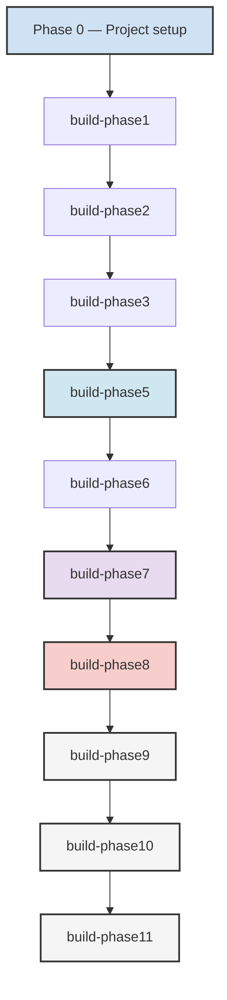

# Traceability Matrix

Central index of the requirement-to-test mappings (TMxxx) recorded across the
build phases. Detailed per-phase rows live in each phase's `spec.md` under its
**Traceability** section; this document is the index across all of them.

**Identifier space in use**: TM001–TM333.

| Range | Introduced by | Detailed rows | Phase status |
|---|---|---|---|
| TM001–TM103 | build-phase1, build-phase2, build-phase3 and the project-setup phase | Held in the introducing phase specifications; no central row detail exists | Per the introducing phase specification |
| TM104–TM124 | build-phase5 | [below](#build-phase5--tm104tm124) | Implemented |
| TM125–TM145 | build-phase6 | [below](#build-phase6--tm125tm145) | Not started |
| TM146–TM155 | build-phase2 | [below](#build-phase2--tm146tm155) | Partial — the data model is delivered; the tests are written with the migration set |
| TM221–TM235 | build-phase7 | [below](#build-phase7--tm221tm235) | Partially implemented |
| TM260–TM277 | build-phase8 | [below](#build-phase8--tm260tm277) | Partially implemented — US1 only |
| TM280–TM297 | build-phase9 | [below](#build-phase9--tm280tm297) | Proposed |
| TM298–TM315 | build-phase10 | [below](#build-phase10--tm298tm315) | Proposed |
| TM316–TM333 | build-phase11 | [below](#build-phase11--tm316tm333) | Proposed |

The ranges TM156–TM220, TM236–TM259 and TM278–TM279 are unallocated: no
phase specification in the repository claims them.

## build-phase5 — TM104–TM124

| Test Mapping | Requirement | User Story | Task | Priority | Status | Notes |
|---|---|---|---|---|---|---|
| **TM104** | FR-040 | US1 | T124, T128, T129 | P1 | ✓ | Distributed tracing implementation — `src/observability/tracing.py` with the OpenTelemetry SDK and OTLP/HTTP exporter |
| **TM105** | FR-040 | US1 | T130–T133 | P1 | ✓ | OpenTelemetry coverage — all four services use `create_service_app`, which installs tracing middleware |
| **TM106** | FR-040 | US1 | T134 | P1 | ✓ | Endpoint traceability — route templates are recorded as span names and W3C context is propagated |
| **TM107** | FR-041 | US2 | T142 | P1 | ✓ | Error tracking system — `services/common/errors.py` |
| **TM108** | FR-041 | US2 | T142, T143 | P1 | ✓ | Structured error reporting |
| **TM109** | FR-041 | US2 | T146 | P1 | ✓ | Request ID correlation — `X-Request-ID` in `src/main.py` |
| **TM110** | FR-042 | US3 | T149 | P2 | ✓ | Health check endpoints — `/healthz`, `/readyz`, `/health` and `/api/v1/health` |
| **TM111** | FR-042 | US3 | T149 | P2 | ✓ | Liveness probe |
| **TM112** | FR-042 | US3 | T149 | P2 | ✓ | Readiness probe |
| **TM113** | FR-043 | US4 | T145 | P2 | ✓ | API key CRUD operations — `src/services/api_keys.py` with one-time secret display and hashed storage |
| **TM114** | FR-043 | US4 | T145 | P2 | ✓ | Scope-based access control — read/write/admin scopes validated on create, update and authentication |
| **TM115** | FR-043 | US4 | T145 | P2 | ✓ | API key lifecycle — create, list, inspect, activate/deactivate and revoke |
| **TM116** | FR-044 | US5 | T144 | P2 | ✓ | Webhook validation — HMAC-SHA256 signatures over the raw request body |
| **TM117** | FR-044 | US5 | T144 | P2 | ✓ | At-least-once delivery — bounded retries with per-attempt delivery records |
| **TM118** | FR-044 | US5 | T144 | P2 | ✓ | Idempotency keys — duplicate deliveries return the original event without reprocessing |
| **TM119** | FR-045 | US6 | T150 | P3 | ✓ | API reference documentation — `docs/API_REFERENCE.md` |
| **TM120** | FR-045 | US6 | T150 | P3 | ✓ | Versioned reference |
| **TM121** | FR-045 | US6 | T150 | P3 | ✓ | 100% endpoint coverage — the reference documents the build-phase3 contract layer and every build-phase8 endpoint that exists; the endpoints that are specified but not yet implemented are listed as planned |
| **TM122** | FR-046 | US1 | T147 | P2 | ✓ | Performance benchmarking — `src/observability/benchmark.py` and `scripts/benchmark_health.py` |
| **TM123** | FR-046 | US1 | T147 | P2 | ✓ | 20% improvement baseline — compared against the phase-3 health and OpenAPI p95 budgets |
| **TM124** | FR-046 | US1 | T147 | P2 | ✓ | Key performance metrics — p50, p95, throughput and error rate |

### User Story 1 (US1) — Distributed tracing — Complete
- **Test Mappings**: TM104–TM106 (3 test mappings)
- **Coverage**: FR-040 (OpenTelemetry distributed tracing)
- **Implementation**: the tracing package configures resource attributes,
  sampling, an OTLP/HTTP exporter and W3C propagation; all four service
  pipelines install the tracing middleware
- **Acceptance**: SC-01 verified by `tests/contract/test_tracing.py`

### User Story 2 (US2) — Error tracking — Complete
- **Test Mappings**: TM107–TM109 (3 test mappings)
- **Coverage**: FR-041 (Centralized error tracking)
- **Implementation**: error tracking system, structured error reporting,
  request ID correlation
- **Acceptance**: SC-02 verified

### User Story 3 (US3) — Health and readiness — Complete
- **Test Mappings**: TM110–TM112 (3 test mappings)
- **Coverage**: FR-042 (Health check endpoints)
- **Implementation**: health check endpoint with liveness and readiness
- **Acceptance**: SC-03 verified

### User Story 4 (US4) — API key management — Complete
- **Test Mappings**: TM113–TM115 (3 test mappings)
- **Coverage**: FR-043 (API key management with CRUD and scope-based access)
- **Implementation**: `APIKeyStore` provides create, list, read, update and
  revoke, with hashed secrets, one-time secret display and scope validation
- **Acceptance**: SC-04 verified by `tests/contract/test_api_keys.py` and
  `tests/contract/test_phase5_api.py`

### User Story 5 (US5) — Webhook pipeline — Complete
- **Test Mappings**: TM116–TM118 (3 test mappings)
- **Coverage**: FR-044 (Webhook validation and event processing)
- **Implementation**: `WebhookProcessor` validates HMAC-SHA256 signatures,
  retries handlers with bounded attempts, records every delivery and dedupes
  idempotency keys
- **Acceptance**: SC-05 verified by `tests/contract/test_webhooks.py` and
  `tests/contract/test_phase5_api.py`

### User Story 6 (US6) — Documentation — Complete
- **Test Mappings**: TM119–TM121 (3 test mappings)
- **Coverage**: FR-045 (Comprehensive API reference documentation)
- **Implementation**: the API reference is versioned and documents every
  endpoint that exists, and names the build-phase8 endpoints that are
  specified but not yet implemented
- **Acceptance**: SC-06 verified

### Performance benchmarking — Complete
- **Test Mappings**: TM122–TM124 (3 test mappings)
- **Coverage**: FR-046 (Performance benchmarking and scaling validation)
- **Implementation**: the benchmark harness measures health and OpenAPI p50,
  p95, throughput and error rate, and compares them with the phase-3 baseline
- **Acceptance**: SC-07 verified by
  `tests/contract/test_performance_benchmark.py` and `scripts/benchmark_health.py`

## build-phase6 — TM125–TM145

Source: `specs/006-build-phase6/spec.md`. Requirements FR-050–FR-056, user
stories US1–US6, tasks T162–T223.

| Test Mapping | Requirement | User Story | Implementing tasks | Priority | Status |
|---|---|---|---|---|---|
| **TM125–TM127** | FR-050 | US1 | T183, T184, T189, T204 | P1 | Not started |
| **TM128–TM130** | FR-051 | US2 | T187, T190, T202 | P1 | Not started |
| **TM131–TM133** | FR-052 | US3 | T188, T203, T205 | P1 | Not started |
| **TM134–TM136** | FR-053 | US4 | T191, T192, T207 | P2 | Not started |
| **TM137–TM139** | FR-054 | US4 | T193, T206, T208 | P2 | Not started |
| **TM140–TM142** | FR-055 | US6 | T209 | P3 | Not started |
| **TM143–TM145** | FR-056 | US5 | T210, T211 | P3 | Not started |

The monitoring stack this phase specifies — Loki, Prometheus, Alertmanager and
Istio — has no configuration, middleware or test in the repository.

## build-phase2 — TM146–TM155

Source: `specs/003-build-phase2/spec.md`. Requirements FR-033–FR-042, user
stories US1–US3, tasks T006–T012. Phase status: **Approved** (2026-10-22).

| Test Mapping | Requirement | User Story | Implementing tasks | Priority | Status |
|---|---|---|---|---|---|
| **TM146** | FR-033 | US1 | T006, T007 | P0 | Partial |
| **TM147** | FR-034 | US1 | T006, T008 | P0 | Partial |
| **TM148** | FR-035 | US1 | T006 | P0 | Partial |
| **TM149** | FR-036 | US1 | T006 | P0 | Partial |
| **TM150** | FR-037 | US2 | T010 | P0 | Not started |
| **TM151** | FR-038 | US2 | T010 | P0 | Not started |
| **TM152** | FR-039 | US2 | T012 | P0 | Not started |
| **TM153** | FR-040 | US3 | T009 | P0 | Not started |
| **TM154** | FR-041 | US1 | T006 | P0 | Partial |
| **TM155** | FR-042 | US1 | T008 | P0 | Partial |

TM146–TM149 and TM154–TM155 cover the data model. The artefact exists — the
conceptual model, the logical data dictionary, and the non-specialist
description are in `specs/003-build-phase2/data-model.md` and
`docs/domain-model/data-model-overview.md` — but no test verifies it yet: the
migration and schema tests are written with the migration set (task T011).
Constitution Art. VII.1 does not allow a mapping to be marked complete without
that evidence, so the rows are **Partial** rather than ✓. TM150–TM153 belong
to the migration set, which has not started.

## build-phase7 — TM221–TM235

Source: `specs/007-build-phase7/spec.md`. Requirements FR-060–FR-065, user
stories US1–US6, tasks T224–T228.

| Test Mapping | Requirement | User Story | Task | Priority | Status |
|---|---|---|---|---|---|
| **TM221–TM223** | FR-060 | US1 | T224 | P1 | Partial |
| **TM224–TM226** | FR-061 | US2 | T225 | P1 | ✓ |
| **TM227–TM229** | FR-062 | US3 | T226 | P1 | ✓ |
| **TM230–TM232** | FR-063 | US4 | T227 | P1 | Not started |
| **TM233–TM235** | FR-064 | US5 | T228 | P1 | ✓ |
| *unallocated* | FR-065 | US6 | *no implementing task* | P2 | Not started |

## build-phase8 — TM260–TM277

Source: `specs/008-build-phase8/spec.md`. Requirements FR-070–FR-075, user
stories US1–US5, tasks T010–T054.

| Test Mapping | Requirement | User Story | Implementing tasks | Priority | Status |
|---|---|---|---|---|---|
| **TM260–TM262** | FR-070 | US1 | T010–T018 | P1 | ✓ |
| **TM263–TM265** | FR-071 | US2 | T019–T025 | P1 | Not started |
| **TM266–TM268** | FR-072 | US3 | T026–T032 | P2 | Not started |
| **TM269–TM271** | FR-073 | US4 | T033–T039 | P2 | Not started |
| **TM272–TM274** | FR-074 | US5 | T040–T045 | P3 | Not started |
| **TM275–TM277** | FR-075 | US5 | T046–T054 | P3 | Not started |

TM260–TM262 are covered by the analytics contract and integration tests in
`tests/contract/test_analytics.py` and `tests/integration/test_analytics.py`.

## build-phase9 — TM280–TM297

Source: `specs/009-build-phase9/spec.md`. Requirements FR-090–FR-095, user
stories US1–US5, tasks T256–T261. Phase status: **Proposed**.

| Test Mapping | Requirement | User Story | Task | Priority | Status |
|---|---|---|---|---|---|
| **TM280–TM282** | FR-090 | US1 | T256 | P1 | Not started |
| **TM283–TM285** | FR-091 | US2 | T257 | P1 | Not started |
| **TM286–TM288** | FR-092 | US3 | T258 | P2 | Not started |
| **TM289–TM291** | FR-093 | US4 | T259 | P2 | Not started |
| **TM292–TM294** | FR-094 | US5 | T260 | P3 | Not started |
| **TM295–TM297** | FR-095 | US5 | T261 | P3 | Not started |

## build-phase10 — TM298–TM315

Source: `specs/010-build-phase10/spec.md`. Requirements FR-100–FR-105, user
stories US1–US5, tasks T262–T267. Phase status: **Proposed**.

| Test Mapping | Requirement | User Story | Task | Priority | Status |
|---|---|---|---|---|---|
| **TM298–TM300** | FR-100 | US1 | T262 | P1 | Not started |
| **TM301–TM303** | FR-101 | US2 | T263 | P1 | Not started |
| **TM304–TM306** | FR-102 | US3 | T264 | P2 | Not started |
| **TM307–TM309** | FR-103 | US4 | T265 | P2 | Not started |
| **TM310–TM312** | FR-104 | US5 | T266 | P3 | Not started |
| **TM313–TM315** | FR-105 | US5 | T267 | P3 | Not started |

## build-phase11 — TM316–TM333

Source: `specs/011-build-phase11/spec.md`. Requirements FR-110–FR-115, user
stories US1–US5, tasks T268–T273. Phase status: **Proposed**.

| Test Mapping | Requirement | User Story | Task | Priority | Status |
|---|---|---|---|---|---|
| **TM316–TM318** | FR-110 | US1 | T268 | P1 | Not started |
| **TM319–TM321** | FR-111 | US2 | T269 | P1 | Not started |
| **TM322–TM324** | FR-112 | US3 | T270 | P2 | Not started |
| **TM325–TM327** | FR-113 | US4 | T271 | P2 | Not started |
| **TM328–TM330** | FR-114 | US5 | T272 | P3 | Not started |
| **TM331–TM333** | FR-115 | US5 | T273 | P3 | Not started |

## Execution Order & Dependencies

## Notes

1. The `Task` column names the tasks that implement the requirement, using the
   identifier that appears in that phase's `tasks.md`. build-phase5,
   build-phase6, build-phase7 and build-phase9 to build-phase11 use a global
   task-identifier range; build-phase1, build-phase3 and build-phase8 use
   phase-local identifiers, so the same identifier can appear in more than one
   phase. The test-mapping range (`TMxxx`) is global throughout.
2. Status values reflect the repository state as of 2026-10-22. A mapping is
   marked ✓ only where the implementation and its tests exist.
3. build-phase8 is partially implemented: only US1 (TM260–TM262) has been
   delivered. Its acceptance criteria remain unchecked in `spec.md`.
4. build-phase9, build-phase10 and build-phase11 are Proposed; their mappings
   are reserved, not yet realized.
5. Constitution articles I.1 (Specification First) and VII.1 (Testing and
   Verifiability) require that a mapping is only marked complete together with
   the specification and the test that proves it.
6. The status vocabulary is: **✓** implemented and verified; **Stub** a module
   exists but does not deliver the mapped behaviour; **Partial** part of the
   mapped behaviour exists; **Not started** no deliverable exists.
