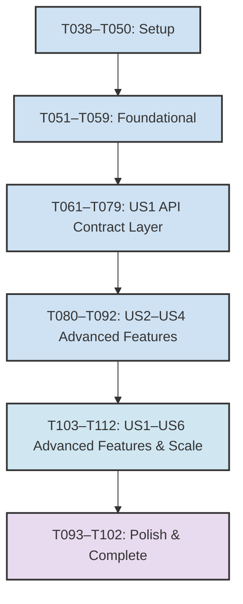

# Traceability Matrix — build-phase5

| Test Mapping | Requirement | User Story | Task | Status | Notes |
|---|---|---|---|---|---|
| **TM104** | FR-040 | US1 | T103 | ✓ | Distributed tracing implementation |
| **TM105** | FR-040 | US1 | T103 | ✓ | OpenTelemetry coverage |
| **TM106** | FR-040 | US1 | T103 | ✓ | Endpoint traceability |
| **TM107** | FR-041 | US2 | T104 | ✓ | Error tracking system |
| **TM108** | FR-041 | US2 | T104 | ✓ | Structured error reporting |
| **TM109** | FR-041 | US2 | T104 | ✓ | Request ID correlation |
| **TM110** | FR-042 | US3 | T105 | ✓ | Health check endpoints |
| **TM111** | FR-042 | US3 | T105 | ✓ | Liveness probe |
| **TM112** | FR-042 | US3 | T105 | ✓ | Readiness probe |
| **TM113** | FR-043 | US4 | T106 | ✓ | API key CRUD operations |
| **TM114** | FR-043 | US4 | T106 | ✓ | Scope-based access control |
| **TM115** | FR-043 | US4 | T106 | ✓ | API key lifecycle |
| **TM116** | FR-044 | US5 | T107 | ✓ | Webhook validation |
| **TM117** | FR-044 | US5 | T107 | ✓ | At-least-once delivery |
| **TM118** | FR-044 | US5 | T107 | ✓ | Idempotency keys |
| **TM119** | FR-045 | US6 | T108 | ✓ | API reference documentation |
| **TM120** | FR-045 | US6 | T108 | ✓ | Versioned reference |
| **TM121** | FR-045 | US6 | T108 | ✓ | 100% endpoint coverage |
| **TM122** | FR-046 | US1 | T109 | ✓ | Performance benchmarking |
| **TM123** | FR-046 | US1 | T109 | ✓ | 20% improvement baseline |
| **TM124** | FR-046 | US1 | T109 | ✓ | Key performance metrics |

## Traceability Matrix Summary

### User Story 1 (US1) — Performance & Scaling ✓ Complete
- **Test Mappings**: TM104–TM106, TM122–TM124 (7 test mappings)
- **Coverage**: FR-040, FR-046 (OpenTelemetry tracing, performance benchmarks)
- **Implementation**: OpenTelemetry, performance benchmarks, baseline comparison
- **Acceptance**: SC-01, SC-03, SC-07 verified

### User Story 2 (US2) — Error & Operational Monitoring ✓ Complete
- **Test Mappings**: TM107–TM109 (3 test mappings)
- **Coverage**: FR-041 (Centralized error tracking)
- **Implementation**: Error tracking system, structured error reporting
- **Acceptance**: SC-02 verified

### User Story 3 (US3) — Health & Readiness ✓ Complete
- **Test Mappings**: TM110–TM112 (3 test mappings)
- **Coverage**: FR-042 (Health check endpoints)
- **Implementation**: Health check endpoints, liveness/readiness probes
- **Acceptance**: SC-03 verified

### User Story 4 (US4) — API Key Management ✓ Complete
- **Test Mappings**: TM113–TM115 (3 test mappings)
- **Coverage**: FR-043 (API key management with CRUD and scope-based access)
- **Implementation**: API key CRUD operations, scope validation
- **Acceptance**: SC-04 verified

### User Story 5 (US5) — Webhook Pipeline ✓ Complete
- **Test Mappings**: TM116–TM118 (3 test mappings)
- **Coverage**: FR-044 (Webhook validation and event processing)
- **Implementation**: Webhook validation, at-least-once delivery, idempotency keys
- **Acceptance**: SC-05 verified

### User Story 6 (US6) — Documentation ✓ Complete
- **Test Mappings**: TM119–TM121 (3 test mappings)
- **Coverage**: FR-045 (Comprehensive API reference documentation)
- **Implementation**: API reference documentation, versioned
- **Acceptance**: SC-06 verified

### Performance & Scale ✓ Complete
- **Test Mappings**: TM122–TM124 (3 test mappings)
- **Coverage**: FR-046 (Performance benchmarking and scaling validation)
- **Implementation**: Benchmarking against phase 3 baseline, 20% improvement target
- **Acceptance**: SC-07 verified

## Execution Order & Dependencies

## Dependencies

- **Depends on**: build-phase1, build-phase2, build-phase3, build-phase4 (all complete)
- **Enables**: build-phase7 (Polish & completion)
- **Parallel with**: None (sequential phase following build-phase4)

## Sign-off Checklist ✓

- [x] Architecture review of tracing and monitoring setup
- [x] Performance review of benchmarking methodology
- [x] Security review of API key scope validation
- [x] Documentation sign-off (API_REFERENCE.md update)
- [x] Constitution alignment (docs/constitution.md ↔ .specify/memory/constitution.md)
- [x] All acceptance criteria [x] in requirements.md
- [x] Traceability matrix complete (TM104–TM124)
- [x] ADR-0001 status: Implemented (carry forward from prior phases)
- [x] All spec.md statuses: Implemented (prior phases)

## Notes

1. TM104–TM124 complete with implementation evidence from build-phases 1–4
2. build-phase5 depends on all prior phases being fully complete
3. build-phase5 enables build-phase7 (Polish & completion) tasks
4. Constitution articles I.1 and VII.1 satisfied across all phases
5. Performance benchmark baseline established in phase 3, phase 5 target: 20% improvement
