# Data Model: build-phase2

**Feature**: Data model and database foundation (`specs/003-build-phase2/spec.md`)
**Date**: 2026-10-22
**Task**: T006 — the conceptual and logical data model

This document is the phase-2 data model. Section 1 is the conceptual model —
what the platform means and how the domains relate. Section 2 is the set of
rules every table follows. Section 3 is the logical model — the data
dictionary, table by table. Section 4 states the critical relationships and
financial invariants the phase-2 exit gate requires.

The decisions behind this model are recorded in
[`research.md`](research.md) as D-01 to D-10; each rule below cites the
decision it comes from. Clause references use the numbered form from
`docs/constitution.md` (Art. XI.4).

The non-specialist description of this model is
[`docs/domain-model/data-model-overview.md`](../../docs/domain-model/data-model-overview.md).

---

## 1. Conceptual model

### 1.1 The four domains

The platform owns four domains. Each is one PostgreSQL schema, and each is
owned by exactly one service (D-01, Art. II.1, Art. V.1).

| Schema | Owning service | What it holds | Classification |
|---|---|---|---|
| `auth` | `auth-service` | Users, roles, permissions, credentials, tokens, security audit events | Restricted |
| `crm` | `crm-service` | Customers, subscribers, contacts, addresses, support tickets and their history | Confidential |
| `inventory` | `inventory-service` | The commercial catalogue, subscriptions, devices, SIMs, assignments, provisioning | Internal |
| `billing` | `billing-service` | Billing accounts, invoices, payments, allocations, the ledger, credit memos | Restricted |

### 1.2 The platform's story in one paragraph

A **customer** buys services. A **subscriber** is the service identity that
carries them. A **subscription** is what a subscriber holds: a rate plan from
the catalogue, plus any add-ons. A **billing account** is what gets invoiced.
An **invoice** is a statement of what was owed in one period; its **lines** are
the individual charges, each priced from a rate-plan version. A **payment** is
money received; **allocations** apply it to invoices. Every financial movement
is written to the **ledger**, which is immutable.

### 1.3 The catalogue is shared, and has one owner

The **catalogue** — products, product versions, rate plans, rate-plan versions,
add-ons — is read by more than one domain: `billing-service` prices from it,
`crm-service` presents it to a customer. It lives in `inventory`, owned by
`inventory-service`, and the other domains read it through that service's API
(D-02, Art. II.4). No other service stores a copy of it.

### 1.4 How the domains reference each other

References that cross a schema boundary carry the other domain's identifier and
nothing else (D-04). No foreign key crosses a schema boundary.

```mermaid
erDiagram
    AUTH_USER ||--o{ AUTH_USER_ROLE : "holds"
    AUTH_ROLE ||--o{ AUTH_USER_ROLE : "granted"
    AUTH_ROLE ||--o{ AUTH_ROLE_PERMISSION : "carries"
    AUTH_PERMISSION ||--o{ AUTH_ROLE_PERMISSION : "included in"
    AUTH_USER ||--o{ AUTH_REFRESH_TOKEN : "issues"
    AUTH_SERVICE_CREDENTIAL ||--o{ AUTH_SECURITY_AUDIT_EVENT : "acts as"
    AUTH_USER ||--o{ AUTH_SECURITY_AUDIT_EVENT : "acts as"

    CRM_CUSTOMER ||--o{ CRM_SUBSCRIBER : "has"
    CRM_CUSTOMER ||--o{ CRM_CONTACT : "reached at"
    CRM_CUSTOMER ||--o{ CRM_ADDRESS : "located at"
    CRM_CUSTOMER ||--o{ CRM_SUPPORT_TICKET : "raises"
    CRM_SUBSCRIBER ||--o{ CRM_SUPPORT_TICKET : "concerns"
    CRM_SUPPORT_TICKET ||--o{ CRM_TICKET_STATUS_HISTORY : "records"
    CRM_SUPPORT_TICKET ||--o{ CRM_TICKET_ASSIGNMENT_HISTORY : "records"
    CRM_SUBSCRIBER ||--o{ CRM_SUBSCRIBER_IDENTITY_LINK : "links"

    INVENTORY_PRODUCT ||--o{ INVENTORY_PRODUCT_VERSION : "versioned by"
    INVENTORY_PRODUCT ||--o| INVENTORY_RATE_PLAN : "sold as"
    INVENTORY_RATE_PLAN ||--o{ INVENTORY_RATE_PLAN_VERSION : "versioned by"
    INVENTORY_PRODUCT ||--o{ INVENTORY_ADD_ON : "sold as"
    INVENTORY_SUBSCRIPTION }o--|| INVENTORY_RATE_PLAN : "prices from"
    INVENTORY_SUBSCRIPTION ||--o{ INVENTORY_SUBSCRIPTION_ADD_ON : "includes"
    INVENTORY_ADD_ON ||--o{ INVENTORY_SUBSCRIPTION_ADD_ON : "attached as"
    INVENTORY_SUBSCRIPTION ||--o{ INVENTORY_PROVISIONING_JOB : "activated by"
    INVENTORY_PROVISIONING_PROFILE ||--o{ INVENTORY_PROVISIONING_JOB : "applied by"
    INVENTORY_DEVICE ||--o{ INVENTORY_DEVICE_ASSIGNMENT : "assigned by"
    INVENTORY_SIM ||--o{ INVENTORY_SIM_ASSIGNMENT : "assigned by"
    INVENTORY_SIM }o--o| INVENTORY_DEVICE : "installed in"

    BILLING_BILLING_ACCOUNT ||--o{ BILLING_INVOICE : "invoiced by"
    BILLING_BILLING_ACCOUNT ||--o{ BILLING_PAYMENT : "paid by"
    BILLING_INVOICE ||--o{ BILLING_INVOICE_LINE : "itemised by"
    BILLING_PAYMENT ||--o{ BILLING_PAYMENT_ALLOCATION : "allocated by"
    BILLING_INVOICE ||--o{ BILLING_PAYMENT_ALLOCATION : "settled by"
    BILLING_LEDGER_ENTRY_GROUP ||--o{ BILLING_LEDGER_ENTRY : "posts"
    BILLING_LEDGER_ACCOUNT ||--o{ BILLING_LEDGER_ENTRY : "holds"
    BILLING_INVOICE ||--o{ BILLING_CREDIT_MEMO : "credited by"
```

The dotted relationships are the cross-schema ones. They are drawn to show
what is related, not what is constrained:

- `crm.subscriber` ← `inventory.subscription` — by `subscriber_id`
- `crm.customer` ← `billing.billing_account` — by `customer_id`
- `crm.subscriber` ← `billing.invoice` — by `subscriber_id`
- `inventory.rate_plan` ← `billing.invoice_line` — by `rate_plan_version_id`
- `auth.user` ← `crm.subscriber_identity_link` — by `identity_user_id`
- `auth.user` ← `crm.support_ticket.assigned_agent_id` — by agent identifier

### 1.5 The conceptual entity groups

| Group | Entities | Domain |
|---|---|---|
| Identity | user, role, permission, user-role, role-permission, refresh token, service credential, security audit event | `auth` |
| Party | customer, contact, address, subscriber, subscriber identity link | `crm` |
| Service delivery | support ticket, ticket status history, ticket assignment history | `crm` |
| Commercial | product, product version, rate plan, rate-plan version, add-on | `inventory` |
| Holding | subscription, subscription add-on | `inventory` |
| Asset | device, device assignment, SIM, SIM assignment | `inventory` |
| Fulfilment | provisioning profile, provisioning job | `inventory` |
| Receivable | billing account, invoice, invoice line, credit memo | `billing` |
| Settlement | payment, payment allocation | `billing` |
| Accounting | ledger account, ledger entry group, ledger entry, tax rate | `billing` |

---

## 2. The rules every table follows

### 2.1 Keys (D-05)

- The primary key is a UUID generated by the application before insert, stored
  as `uuid`. No sequence backs a primary key.
- A table that has a natural key carries it as a `unique` constraint, never as
  the primary key.
- A foreign key that stays inside a schema is declared with an explicit
  `ON DELETE` rule.
- A reference that crosses a schema boundary is a bare `uuid` column with no
  foreign key (D-04). The dictionary marks those columns as
  *cross-schema reference*.

### 2.2 Audit fields (D-06)

Every table carries `created_at`, `updated_at`, `created_by`, `updated_by`, and
`version`. `created_by` and `updated_by` identify the acting principal or the
owning service and are never foreign keys, so the audit trail survives the
deletion of the principal.

### 2.3 Types and units (D-07, D-08)

| Kind of value | Type | Rule |
|---|---|---|
| Money | `numeric(19, 4)` | Always accompanied by an ISO 4217 currency code; never a floating-point type |
| Quantity | `integer` | A count; a fractional quantity is `numeric(12, 3)` |
| Percentage or rate | `numeric(9, 6)` | Tax and discount rates |
| Timestamp | `timestamptz` | Stored in UTC; a business calendar fact is `date` |
| Identifier | `uuid` | Generated by the application |
| Code | `varchar` or `text` | An external standard's code, validated at the boundary (D-02) |
| Free-form extension | `jsonb` | Only where the shape is genuinely open; never a substitute for a declared column |

### 2.4 Deletion (D-09)

A referenced row is `ON DELETE RESTRICT` unless it is a child row with no
independent meaning. Nothing cascades across a schema boundary. A posted
ledger entry, a posted invoice, and a security audit event are never deleted;
they are voided or superseded.

### 2.5 Classification (D-10)

Every table in the dictionary carries its classification: `Restricted`,
`Confidential`, or `Internal`.

### 2.6 Effective dating (D-03)

Three forms, chosen by the kind of data:

| Form | Marker | Where it applies |
|---|---|---|
| Temporal | `valid_from`, `valid_to` (`valid_to IS NULL` means current) | Product version, rate-plan version, subscription, subscription add-on, SIM assignment, device assignment, address, tax rate |
| Append-only | The row is written once and never updated | Security audit event, ticket status history, ticket assignment history, ledger entry, ledger entry group, credit-memo approval step |
| Snapshot | The row copies the terms it was priced from | Invoice line, credit memo |

A table with no temporal columns and no append-only rule expresses its
lifecycle through its status column.

---

## 3. Logical data dictionary

### 3.1 `auth` — owned by `auth-service`

#### `auth.user`

A human who can sign in. Classification: **Restricted**.

| Column | Type | Rules |
|---|---|---|
| `id` | `uuid` | Primary key (D-05) |
| `username` | `varchar(64)` | Not null, unique, immutable |
| `email` | `varchar(320)` | Not null, unique (case-insensitive) |
| `password_hash` | `varchar(255)` | Not null; the hash, never the password |
| `status` | `varchar(16)` | Not null; `pending`, `active`, `locked`, `disabled`; default `pending` |
| `failed_login_count` | `integer` | Not null; default 0 |
| `locked_until` | `timestamptz` | Nullable; set when the lock is applied |
| `last_login_at` | `timestamptz` | Nullable |
| `password_changed_at` | `timestamptz` | Not null |
| `token_version` | `integer` | Not null; default 1; incrementing it invalidates every token the user holds |
| audit fields | — | D-06 |

Lifecycle: `pending` → `active` → (`locked` → `active`) → `disabled`. A
disabled user is never reactivated; a new user is created instead.

Indexes: unique on `username`; unique on `lower(email)`; index on `status`.

#### `auth.role`

A named set of permissions. Classification: **Internal**.

| Column | Type | Rules |
|---|---|---|
| `id` | `uuid` | Primary key |
| `code` | `varchar(64)` | Not null, unique, immutable |
| `name` | `varchar(128)` | Not null |
| `description` | `text` | Nullable |
| `is_system` | `boolean` | Not null; default false; a system role cannot be deleted |
| audit fields | — | D-06 |

Indexes: unique on `code`.

#### `auth.permission`

One grantable capability. Classification: **Internal**.

| Column | Type | Rules |
|---|---|---|
| `id` | `uuid` | Primary key |
| `code` | `varchar(96)` | Not null, unique, immutable |
| `description` | `text` | Nullable |
| `resource` | `varchar(64)` | Not null; the domain the permission acts in |
| `action` | `varchar(64)` | Not null; the operation it allows |
| audit fields | — | D-06 |

Indexes: unique on `code`; index on (`resource`, `action`).

#### `auth.user_role`

The grant of a role to a user. Classification: **Internal**.

| Column | Type | Rules |
|---|---|---|
| `user_id` | `uuid` | Primary key part; foreign key → `auth.user.id`, `ON DELETE CASCADE` |
| `role_id` | `uuid` | Primary key part; foreign key → `auth.role.id`, `ON DELETE RESTRICT` |
| `granted_at` | `timestamptz` | Not null |
| `granted_by` | `uuid` | Not null; cross-schema reference to the granting principal's identifier |
| `expires_at` | `timestamptz` | Nullable; a time-limited grant |
| audit fields | — | D-06 |

Indexes: primary key on (`user_id`, `role_id`); index on `role_id`.

#### `auth.role_permission`

The permissions a role carries. Classification: **Internal**.

| Column | Type | Rules |
|---|---|---|
| `role_id` | `uuid` | Primary key part; foreign key → `auth.role.id`, `ON DELETE CASCADE` |
| `permission_id` | `uuid` | Primary key part; foreign key → `auth.permission.id`, `ON DELETE CASCADE` |
| `granted_at` | `timestamptz` | Not null |
| audit fields | — | D-06 |

Indexes: primary key on (`role_id`, `permission_id`).

#### `auth.refresh_token`

A refreshable token. Only its hash is stored. Classification: **Restricted**.

| Column | Type | Rules |
|---|---|---|
| `id` | `uuid` | Primary key |
| `user_id` | `uuid` | Not null; foreign key → `auth.user.id`, `ON DELETE CASCADE` |
| `token_hash` | `varchar(128)` | Not null, unique; the hash of the token, never the token |
| `issued_at` | `timestamptz` | Not null |
| `expires_at` | `timestamptz` | Not null |
| `revoked_at` | `timestamptz` | Nullable |
| `replaced_by` | `uuid` | Nullable; foreign key → `auth.refresh_token.id`; set when the token is rotated |
| `user_agent_hash` | `varchar(128)` | Nullable; the hash of the client fingerprint, not the fingerprint |

Indexes: unique on `token_hash`; index on (`user_id`, `expires_at`).

#### `auth.service_credential`

A credential for a service-to-service identity. Classification: **Restricted**.

| Column | Type | Rules |
|---|---|---|
| `id` | `uuid` | Primary key |
| `service_name` | `varchar(64)` | Not null, unique |
| `credential_hash` | `varchar(255)` | Not null; the hash, never the secret |
| `status` | `varchar(16)` | Not null; `active`, `revoked` |
| `scopes` | `text[]` | Not null; default `{}`; the capabilities the credential carries |
| `rotated_at` | `timestamptz` | Nullable |
| `revoked_at` | `timestamptz` | Nullable |
| audit fields | — | D-06 |

#### `auth.security_audit_event`

An append-only record of a security-sensitive action. Classification:
**Restricted**.

| Column | Type | Rules |
|---|---|---|
| `id` | `bigint` | Primary key; a sequence-backed surrogate, because this table is append-only and never referenced by a business row |
| `occurred_at` | `timestamptz` | Not null |
| `actor_type` | `varchar(16)` | Not null; `user`, `service`, `system` |
| `actor_id` | `uuid` | Nullable; the acting principal's identifier |
| `action` | `varchar(96)` | Not null; e.g. `auth.login.failed` |
| `target_type` | `varchar(64)` | Nullable |
| `target_id` | `uuid` | Nullable |
| `outcome` | `varchar(16)` | Not null; `success`, `failure`, `denied` |
| `correlation_id` | `varchar(64)` | Not null; the request correlation identifier (Art. VIII.1) |
| `source_ip` | `inet` | Nullable |
| `detail` | `jsonb` | Not null; default `{}`; never holds a secret or a personal datum (Art. VIII.5) |

Rule: append-only — rows are inserted and never updated or deleted (D-03).

Indexes: index on (`actor_id`, `occurred_at`); index on (`action`, `occurred_at`);
index on `correlation_id`.

### 3.2 `crm` — owned by `crm-service`

#### `crm.customer`

The party a subscription and a billing account belong to. Classification:
**Confidential**.

| Column | Type | Rules |
|---|---|---|
| `id` | `uuid` | Primary key |
| `external_reference` | `varchar(64)` | Not null, unique; the customer's reference in the operator's own systems |
| `legal_name` | `varchar(255)` | Not null |
| `display_name` | `varchar(255)` | Nullable |
| `customer_type` | `varchar(16)` | Not null; `individual`, `organization` |
| `status` | `varchar(16)` | Not null; `prospect`, `active`, `suspended`, `closed`; default `prospect` |
| `tax_identifier` | `varchar(64)` | Nullable |
| `opened_at` | `timestamptz` | Not null |
| `closed_at` | `timestamptz` | Nullable |
| audit fields | — | D-06 |

Lifecycle: `prospect` → `active` → `suspended` → `active` → `closed`. A closed
customer is not reopened.

Indexes: unique on `external_reference`; index on `status`; index on
`lower(legal_name)`.

#### `crm.contact`

A way to reach a customer. Classification: **Confidential**.

| Column | Type | Rules |
|---|---|---|
| `id` | `uuid` | Primary key |
| `customer_id` | `uuid` | Not null; foreign key → `crm.customer.id`, `ON DELETE RESTRICT` |
| `contact_type` | `varchar(16)` | Not null; `email`, `phone`, `postal`, `other` |
| `contact_value` | `varchar(320)` | Not null; as given |
| `normalized_value` | `varchar(320)` | Not null; the searchable form of the value |
| `is_primary` | `boolean` | Not null; default false; at most one primary contact per type per customer |
| `status` | `varchar(16)` | Not null; `active`, `inactive`; default `active` |
| audit fields | — | D-06 |

Indexes: index on (`customer_id`); index on `normalized_value`.

#### `crm.address`

Where a customer is located. Classification: **Confidential**.

| Column | Type | Rules |
|---|---|---|
| `id` | `uuid` | Primary key |
| `customer_id` | `uuid` | Not null; foreign key → `crm.customer.id`, `ON DELETE RESTRICT` |
| `line1` | `varchar(255)` | Not null |
| `line2` | `varchar(255)` | Nullable |
| `city` | `varchar(128)` | Not null |
| `region` | `varchar(128)` | Nullable |
| `postal_code` | `varchar(32)` | Nullable |
| `country_code` | `char(2)` | Not null; ISO 3166-1 alpha-2 (D-02) |
| `address_type` | `varchar(16)` | Not null; `billing`, `service`, `other` |
| `valid_from` | `timestamptz` | Not null; temporal form (D-03) |
| `valid_to` | `timestamptz` | Nullable; `NULL` means current |
| audit fields | — | D-06 |

Indexes: index on (`customer_id`, `valid_from`); index on `country_code`.

#### `crm.subscriber`

The service identity a subscription is held by. Classification:
**Confidential**.

| Column | Type | Rules |
|---|---|---|
| `id` | `uuid` | Primary key |
| `customer_id` | `uuid` | Not null; foreign key → `crm.customer.id`, `ON DELETE RESTRICT` |
| `subscriber_number` | `varchar(32)` | Not null, unique, immutable |
| `status` | `varchar(16)` | Not null; `pending`, `active`, `suspended`, `terminated` |
| `activated_on` | `timestamptz` | Nullable |
| `terminated_on` | `timestamptz` | Nullable |
| `suspended_at` | `timestamptz` | Nullable |
| audit fields | — | D-06 |

Lifecycle: `pending` → `active` → `suspended` → `active` → `terminated`. A
terminated subscriber is not reactivated.

Indexes: unique on `subscriber_number`; index on (`customer_id`, `status`).

#### `crm.subscriber_identity_link`

The link between a subscriber and the user account that operates it. This is
the boundary case of D-04: the user lives in `auth`, so the link carries the
identifier and declares no foreign key. Classification: **Confidential**.

| Column | Type | Rules |
|---|---|---|
| `id` | `uuid` | Primary key |
| `subscriber_id` | `uuid` | Not null; foreign key → `crm.subscriber.id`, `ON DELETE CASCADE` |
| `identity_user_id` | `uuid` | Not null; cross-schema reference → `auth.user.id` |
| `link_type` | `varchar(16)` | Not null; `primary`, `secondary` |
| `linked_at` | `timestamptz` | Not null |
| `unlinked_at` | `timestamptz` | Nullable |
| audit fields | — | D-06 |

Indexes: index on (`subscriber_id`); index on (`identity_user_id`); a partial
unique index that permits only one `primary` link per subscriber with
`unlinked_at IS NULL`.

#### `crm.support_ticket`

A support case. Classification: **Confidential**.

| Column | Type | Rules |
|---|---|---|
| `id` | `uuid` | Primary key |
| `customer_id` | `uuid` | Not null; foreign key → `crm.customer.id`, `ON DELETE RESTRICT` |
| `subscriber_id` | `uuid` | Nullable; foreign key → `crm.subscriber.id`, `ON DELETE RESTRICT` |
| `ticket_number` | `varchar(32)` | Not null, unique |
| `subject` | `varchar(255)` | Not null |
| `status` | `varchar(16)` | Not null; `open`, `pending`, `resolved`, `closed` |
| `priority` | `varchar(16)` | Not null; `low`, `normal`, `high`, `urgent`; default `normal` |
| `assigned_agent_id` | `uuid` | Nullable; cross-schema reference → `auth.user.id` |
| `opened_at` | `timestamptz` | Not null |
| `resolved_at` | `timestamptz` | Nullable |
| `closed_at` | `timestamptz` | Nullable |
| audit fields | — | D-06 |

Indexes: unique on `ticket_number`; index on (`customer_id`, `status`);
index on `assigned_agent_id`; index on `opened_at`.

#### `crm.ticket_status_history`

The status trail of a ticket. Append-only. Classification: **Confidential**.

| Column | Type | Rules |
|---|---|---|
| `id` | `bigint` | Primary key; sequence-backed, append-only |
| `ticket_id` | `uuid` | Not null; foreign key → `crm.support_ticket.id`, `ON DELETE CASCADE` |
| `from_status` | `varchar(16)` | Nullable; `NULL` for the opening entry |
| `to_status` | `varchar(16)` | Not null |
| `changed_at` | `timestamptz` | Not null |
| `changed_by` | `uuid` | Nullable; cross-schema reference → `auth.user.id` |
| `reason` | `text` | Nullable |

Rule: append-only (D-03).

Indexes: index on (`ticket_id`, `changed_at`).

#### `crm.ticket_assignment_history`

The assignment trail of a ticket. Append-only. Classification:
**Confidential**.

| Column | Type | Rules |
|---|---|---|
| `id` | `bigint` | Primary key; sequence-backed, append-only |
| `ticket_id` | `uuid` | Not null; foreign key → `crm.support_ticket.id`, `ON DELETE CASCADE` |
| `from_agent_id` | `uuid` | Nullable; cross-schema reference → `auth.user.id` |
| `to_agent_id` | `uuid` | Not null; cross-schema reference → `auth.user.id` |
| `changed_at` | `timestamptz` | Not null |
| `changed_by` | `uuid` | Nullable; cross-schema reference → `auth.user.id` |

Rule: append-only (D-03).

Indexes: index on (`ticket_id`, `changed_at`).

### 3.3 `inventory` — owned by `inventory-service`

#### `inventory.product`

A sellable thing, or a family of them. Classification: **Internal**.

| Column | Type | Rules |
|---|---|---|
| `id` | `uuid` | Primary key |
| `product_code` | `varchar(64)` | Not null, unique, immutable |
| `name` | `varchar(255)` | Not null |
| `product_type` | `varchar(24)` | Not null; `plan`, `addon`, `device` |
| `description` | `text` | Nullable |
| `status` | `varchar(16)` | Not null; `draft`, `active`, `retired`; default `draft` |
| audit fields | — | D-06 |

Indexes: unique on `product_code`; index on (`product_type`, `status`).

#### `inventory.product_version`

A versioned definition of a product. Temporal. Classification: **Internal**.

| Column | Type | Rules |
|---|---|---|
| `id` | `uuid` | Primary key |
| `product_id` | `uuid` | Not null; foreign key → `inventory.product.id`, `ON DELETE RESTRICT` |
| `version_number` | `integer` | Not null; starts at 1 |
| `valid_from` | `timestamptz` | Not null; temporal form (D-03) |
| `valid_to` | `timestamptz` | Nullable; `NULL` means current |
| `definition` | `jsonb` | Not null; the versioned attributes |
| `approved_at` | `timestamptz` | Nullable; a version is not sellable until it is approved |
| audit fields | — | D-06 |

Rule: at most one current version per product — a partial unique index on
(`product_id`) where `valid_to IS NULL`.

Indexes: unique on (`product_id`, `version_number`).

#### `inventory.rate_plan`

The commercial plan a subscription is held on. Classification: **Internal**.

| Column | Type | Rules |
|---|---|---|
| `id` | `uuid` | Primary key |
| `product_id` | `uuid` | Not null; unique; foreign key → `inventory.product.id`, `ON DELETE RESTRICT` |
| `plan_code` | `varchar(64)` | Not null, unique, immutable |
| `billing_interval` | `varchar(16)` | Not null; `monthly`, `quarterly`, `annual`, `one_time` |
| `currency_code` | `char(3)` | Not null; ISO 4217 (D-02) |
| `status` | `varchar(16)` | Not null; `draft`, `active`, `retired` |
| audit fields | — | D-06 |

Indexes: unique on `plan_code`.

#### `inventory.rate_plan_version`

The priced terms of a rate plan over a period. Temporal. Classification:
**Internal**.

| Column | Type | Rules |
|---|---|---|
| `id` | `uuid` | Primary key |
| `rate_plan_id` | `uuid` | Not null; foreign key → `inventory.rate_plan.id`, `ON DELETE RESTRICT` |
| `version_number` | `integer` | Not null; starts at 1 |
| `valid_from` | `timestamptz` | Not null; temporal form (D-03) |
| `valid_to` | `timestamptz` | Nullable; `NULL` means current |
| `base_price` | `numeric(19, 4)` | Not null; the recurring price (D-07) |
| `currency_code` | `char(3)` | Not null; ISO 4217 |
| `quota` | `jsonb` | Not null; default `{}`; the allowance terms |
| `terms` | `jsonb` | Not null; default `{}`; the contractual terms |
| `approved_at` | `timestamptz` | Nullable |
| audit fields | — | D-06 |

Rule: at most one current version per rate plan — a partial unique index on
(`rate_plan_id`) where `valid_to IS NULL`.

Indexes: unique on (`rate_plan_id`, `version_number`).

#### `inventory.add_on`

An optional product attached to a subscription. Classification: **Internal**.

| Column | Type | Rules |
|---|---|---|
| `id` | `uuid` | Primary key |
| `product_id` | `uuid` | Not null; foreign key → `inventory.product.id`, `ON DELETE RESTRICT` |
| `add_on_code` | `varchar(64)` | Not null, unique, immutable |
| `name` | `varchar(255)` | Not null |
| `price` | `numeric(19, 4)` | Not null |
| `currency_code` | `char(3)` | Not null; ISO 4217 |
| `billing_interval` | `varchar(16)` | Not null; matches the rate plan's interval |
| `status` | `varchar(16)` | Not null; `draft`, `active`, `retired` |
| audit fields | — | D-06 |

Indexes: unique on `add_on_code`.

#### `inventory.subscription`

What a subscriber holds. Temporal. Classification: **Internal**.

| Column | Type | Rules |
|---|---|---|
| `id` | `uuid` | Primary key |
| `subscriber_id` | `uuid` | Not null; cross-schema reference → `crm.subscriber.id` (D-04) |
| `rate_plan_id` | `uuid` | Not null; foreign key → `inventory.rate_plan.id`, `ON DELETE RESTRICT` |
| `status` | `varchar(24)` | Not null; `draft`, `pending_activation`, `active`, `suspended`, `cancelled`, `expired` |
| `valid_from` | `timestamptz` | Not null; temporal form (D-03) |
| `valid_to` | `timestamptz` | Nullable; `NULL` means current |
| `activated_at` | `timestamptz` | Nullable |
| `cancelled_at` | `timestamptz` | Nullable |
| `pricing_snapshot` | `jsonb` | Not null; default `{}`; the commercial terms captured at activation, so a change to the catalogue does not rewrite history |
| audit fields | — | D-06 |

Lifecycle: `draft` → `pending_activation` → `active` → (`suspended` → `active`)
→ `cancelled`. A cancelled subscription is not reactivated; a new one is
created.

Indexes: index on (`subscriber_id`, `status`); index on `valid_from`; index on
(`rate_plan_id`, `status`).

#### `inventory.subscription_add_on`

An add-on attached to a subscription. Temporal. Classification: **Internal**.

| Column | Type | Rules |
|---|---|---|
| `id` | `uuid` | Primary key |
| `subscription_id` | `uuid` | Not null; foreign key → `inventory.subscription.id`, `ON DELETE RESTRICT` |
| `add_on_id` | `uuid` | Not null; foreign key → `inventory.add_on.id`, `ON DELETE RESTRICT` |
| `quantity` | `integer` | Not null; default 1; greater than zero |
| `status` | `varchar(16)` | Not null; `active`, `cancelled` |
| `valid_from` | `timestamptz` | Not null; temporal form (D-03) |
| `valid_to` | `timestamptz` | Nullable; `NULL` means current |
| audit fields | — | D-06 |

Indexes: unique on (`subscription_id`, `add_on_id`, `valid_from`); index on
(`subscription_id`, `status`).

#### `inventory.device`

A physical device. Classification: **Internal**.

| Column | Type | Rules |
|---|---|---|
| `id` | `uuid` | Primary key |
| `serial_number` | `varchar(64)` | Not null, unique, immutable |
| `imei` | `varchar(20)` | Nullable, unique; the TAC and serial form |
| `device_type` | `varchar(48)` | Not null |
| `manufacturer` | `varchar(128)` | Nullable |
| `model` | `varchar(128)` | Nullable |
| `status` | `varchar(24)` | Not null; `in_stock`, `reserved`, `assigned`, `faulty`, `retired` |
| `acquired_at` | `timestamptz` | Nullable |
| audit fields | — | D-06 |

Lifecycle: `in_stock` → `reserved` → `assigned` → (`assigned` → `in_stock` on
return) → `retired`. A device that is `retired` is never re-issued.

Indexes: unique on `serial_number`; unique on `imei` where not null; index on
`status`.

#### `inventory.device_assignment`

Which subscriber holds a device, and for how long. Temporal. Classification:
**Internal**.

| Column | Type | Rules |
|---|---|---|
| `id` | `uuid` | Primary key |
| `device_id` | `uuid` | Not null; foreign key → `inventory.device.id`, `ON DELETE RESTRICT` |
| `subscriber_id` | `uuid` | Not null; cross-schema reference → `crm.subscriber.id` |
| `subscription_id` | `uuid` | Nullable; cross-schema reference → `inventory.subscription.id` |
| `assigned_at` | `timestamptz` | Not null; temporal form (D-03) |
| `released_at` | `timestamptz` | Nullable; `NULL` means current |
| `reason` | `varchar(32)` | Nullable; `activation`, `replacement`, `return` |
| audit fields | — | D-06 |

Indexes: index on (`device_id`, `assigned_at`); index on `subscriber_id`; a
partial unique index on (`device_id`) where `released_at IS NULL`.

#### `inventory.sim`

A SIM identity. Classification: **Internal**.

| Column | Type | Rules |
|---|---|---|
| `id` | `uuid` | Primary key |
| `iccid` | `varchar(24)` | Not null, unique, immutable |
| `sim_type` | `varchar(16)` | Not null; `physical`, `esim` |
| `msisdn` | `varchar(32)` | Nullable, unique; the subscriber number reachable on this SIM |
| `carrier` | `varchar(64)` | Nullable |
| `device_id` | `uuid` | Nullable; foreign key → `inventory.device.id`, `ON DELETE RESTRICT` |
| `status` | `varchar(24)` | Not null; `in_stock`, `reserved`, `assigned`, `active`, `retired` |
| audit fields | — | D-06 |

Indexes: unique on `iccid`; unique on `msisdn` where not null; index on
`status`.

#### `inventory.sim_assignment`

Which subscriber holds a SIM, and for how long. Temporal. Classification:
**Internal**.

| Column | Type | Rules |
|---|---|---|
| `id` | `uuid` | Primary key |
| `sim_id` | `uuid` | Not null; foreign key → `inventory.sim.id`, `ON DELETE RESTRICT` |
| `subscriber_id` | `uuid` | Not null; cross-schema reference → `crm.subscriber.id` |
| `subscription_id` | `uuid` | Nullable; cross-schema reference → `inventory.subscription.id` |
| `assigned_at` | `timestamptz` | Not null; temporal form (D-03) |
| `released_at` | `timestamptz` | Nullable; `NULL` means current |
| `audit fields` | — | D-06 |

Indexes: index on (`sim_id`, `assigned_at`); index on `subscriber_id`; a
partial unique index on (`sim_id`) where `released_at IS NULL`.

#### `inventory.provisioning_profile`

The configuration template a provisioning job applies. Classification:
**Internal**.

| Column | Type | Rules |
|---|---|---|
| `id` | `uuid` | Primary key |
| `profile_code` | `varchar(64)` | Not null, unique, immutable |
| `name` | `varchar(128)` | Not null |
| `apn` | `varchar(64)` | Nullable |
| `parameters` | `jsonb` | Not null; default `{}`; the profile's settings |
| `status` | `varchar(16)` | Not null; `active`, `retired` |
| audit fields | — | D-06 |

Indexes: unique on `profile_code`.

#### `inventory.provisioning_job`

A request to activate or change a service. Classification: **Internal**.

| Column | Type | Rules |
|---|---|---|
| `id` | `uuid` | Primary key |
| `subscription_id` | `uuid` | Not null; foreign key → `inventory.subscription.id`, `ON DELETE RESTRICT` |
| `subscriber_id` | `uuid` | Not null; cross-schema reference → `crm.subscriber.id` |
| `profile_id` | `uuid` | Not null; foreign key → `inventory.provisioning_profile.id`, `ON DELETE RESTRICT` |
| `job_type` | `varchar(24)` | Not null; `activate`, `change`, `deactivate`, `reconcile` |
| `status` | `varchar(16)` | Not null; `queued`, `running`, `succeeded`, `failed`, `cancelled` |
| `idempotency_key` | `varchar(128)` | Not null, unique; a repeated request with the same key does not create a second job |
| `attempt_count` | `integer` | Not null; default 0 |
| `requested_at` | `timestamptz` | Not null |
| `started_at` | `timestamptz` | Nullable |
| `completed_at` | `timestamptz` | Nullable |
| `failure_code` | `varchar(64)` | Nullable |
| `failure_detail` | `text` | Nullable; sanitised — it holds no credential and no personal datum (Art. VIII.5) |
| `correlation_id` | `varchar(64)` | Not null (Art. VIII.1) |
| audit fields | — | D-06 |

Indexes: unique on `idempotency_key`; index on (`subscription_id`, `status`);
index on `status`.

### 3.4 `billing` — owned by `billing-service`

#### `billing.billing_account`

The entity an invoice is issued to. Classification: **Restricted**.

| Column | Type | Rules |
|---|---|---|
| `id` | `uuid` | Primary key |
| `customer_id` | `uuid` | Not null; cross-schema reference → `crm.customer.id` (D-04) |
| `account_number` | `varchar(32)` | Not null, unique, immutable |
| `account_name` | `varchar(255)` | Not null |
| `status` | `varchar(16)` | Not null; `active`, `suspended`, `closed` |
| `currency_code` | `char(3)` | Not null; ISO 4217; the currency the account is invoiced in |
| `billing_cycle_day` | `integer` | Not null; the day of the month the invoice is issued, 1–28 |
| `payment_terms_days` | `integer` | Not null; default 0 |
| `opened_at` | `timestamptz` | Not null |
| `closed_at` | `timestamptz` | Nullable |
| audit fields | — | D-06 |

Indexes: unique on `account_number`; index on (`customer_id`, `status`).

#### `billing.invoice`

A statement of what was owed. Classification: **Restricted**.

| Column | Type | Rules |
|---|---|---|
| `id` | `uuid` | Primary key |
| `billing_account_id` | `uuid` | Not null; foreign key → `billing.billing_account.id`, `ON DELETE RESTRICT` |
| `subscriber_id` | `uuid` | Nullable; cross-schema reference → `crm.subscriber.id` |
| `invoice_number` | `varchar(32)` | Not null, unique, immutable |
| `status` | `varchar(16)` | Not null; `draft`, `issued`, `partially_paid`, `paid`, `overdue`, `void` |
| `currency_code` | `char(3)` | Not null; ISO 4217 |
| `period_start` | `timestamptz` | Not null; the start of the period charged |
| `period_end` | `timestamptz` | Not null; the end of the period charged |
| `issue_date` | `date` | Nullable; set when the invoice is issued |
| `due_date` | `date` | Nullable |
| `subtotal` | `numeric(19, 4)` | Not null; default 0 |
| `tax_total` | `numeric(19, 4)` | Not null; default 0 |
| `total` | `numeric(19, 4)` | Not null; default 0 |
| `issued_at` | `timestamptz` | Nullable |
| `paid_at` | `timestamptz` | Nullable |
| `voided_at` | `timestamptz` | Nullable |
| audit fields | — | D-06 |

Rule: a posted invoice is never updated in its totals or deleted; a change is
made by a credit memo (D-09).

Indexes: unique on `invoice_number`; index on (`billing_account_id`, `status`);
index on (`status`, `due_date`).

#### `billing.invoice_line`

One charge on an invoice. Snapshot. Classification: **Restricted**.

| Column | Type | Rules |
|---|---|---|
| `id` | `uuid` | Primary key |
| `invoice_id` | `uuid` | Not null; foreign key → `billing.invoice.id`, `ON DELETE RESTRICT` |
| `line_type` | `varchar(24)` | Not null; `subscription`, `addon`, `usage`, `adjustment`, `credit`, `tax` |
| `description` | `varchar(255)` | Not null |
| `product_code` | `varchar(64)` | Nullable; the catalogue code as it was when the line was written |
| `rate_plan_version_id` | `uuid` | Nullable; cross-schema reference → `inventory.rate_plan_version.id` |
| `quantity` | `numeric(12, 3)` | Not null; default 1 |
| `unit_price` | `numeric(19, 4)` | Not null |
| `amount` | `numeric(19, 4)` | Not null |
| `tax_rate` | `numeric(9, 6)` | Nullable; the rate applied (D-07) |
| `tax_amount` | `numeric(19, 4)` | Not null; default 0 |
| `currency_code` | `char(3)` | Not null; ISO 4217 |
| `price_snapshot` | `jsonb` | Not null; default `{}`; the price, quota, and terms copied from the rate-plan version (D-03) |
| `period_start` | `timestamptz` | Nullable; the period the charge covers |
| `period_end` | `timestamptz` | Nullable |
| audit fields | — | D-06 |

Indexes: index on `invoice_id`; index on `product_code`.

#### `billing.payment`

Money received. Classification: **Restricted**.

| Column | Type | Rules |
|---|---|---|
| `id` | `uuid` | Primary key |
| `billing_account_id` | `uuid` | Not null; foreign key → `billing.billing_account.id`, `ON DELETE RESTRICT` |
| `payment_reference` | `varchar(64)` | Not null, unique, immutable |
| `status` | `varchar(16)` | Not null; `pending`, `authorized`, `captured`, `partially_refunded`, `refunded`, `failed` |
| `amount` | `numeric(19, 4)` | Not null |
| `currency_code` | `char(3)` | Not null; ISO 4217 |
| `method` | `varchar(32)` | Nullable; `card`, `transfer`, `cash`, `credit_note` |
| `external_reference` | `varchar(128)` | Nullable; the payment provider's identifier |
| `idempotency_key` | `varchar(128)` | Not null, unique |
| `received_at` | `timestamptz` | Not null |
| `captured_at` | `timestamptz` | Nullable |
| audit fields | — | D-06 |

Indexes: unique on `payment_reference`; unique on `idempotency_key`; index on
(`billing_account_id`, `status`).

#### `billing.payment_allocation`

The part of a payment applied to an invoice. Classification: **Restricted**.

| Column | Type | Rules |
|---|---|---|
| `id` | `uuid` | Primary key |
| `payment_id` | `uuid` | Not null; foreign key → `billing.payment.id`, `ON DELETE RESTRICT` |
| `invoice_id` | `uuid` | Not null; foreign key → `billing.invoice.id`, `ON DELETE RESTRICT` |
| `amount` | `numeric(19, 4)` | Not null |
| `currency_code` | `char(3)` | Not null; ISO 4217; equal to the payment's currency |
| `allocated_at` | `timestamptz` | Not null |
| audit fields | — | D-06 |

Rule: the sum of a payment's allocations may not exceed the payment amount, and
may not exceed the invoice's outstanding balance. The constraint is enforced by
the billing service, and verified by the phase-6 tests; the database stores
the amounts that make the check possible.

Indexes: index on `payment_id`; index on `invoice_id`.

#### `billing.credit_memo`

A credit issued against an invoice. Classification: **Restricted**.

| Column | Type | Rules |
|---|---|---|
| `id` | `uuid` | Primary key |
| `credit_memo_number` | `varchar(32)` | Not null, unique, immutable |
| `billing_account_id` | `uuid` | Not null; foreign key → `billing.billing_account.id`, `ON DELETE RESTRICT` |
| `invoice_id` | `uuid` | Not null; foreign key → `billing.invoice.id`, `ON DELETE RESTRICT` |
| `status` | `varchar(24)` | Not null; `draft`, `pending_approval`, `approved`, `rejected`, `posted`, `void` |
| `amount` | `numeric(19, 4)` | Not null |
| `currency_code` | `char(3)` | Not null; ISO 4217 |
| `reason` | `varchar(255)` | Not null |
| `requested_by` | `uuid` | Not null; cross-schema reference → `auth.user.id` |
| `requested_at` | `timestamptz` | Not null |
| `approved_by` | `uuid` | Nullable; cross-schema reference → `auth.user.id` |
| `approved_at` | `timestamptz` | Nullable |
| `rejected_reason` | `text` | Nullable |
| `posted_at` | `timestamptz` | Nullable |
| audit fields | — | D-06 |

Rule: a posted credit memo is never updated or deleted; it is voided by a
compensating entry (D-09). The approval threshold and the separation-of-duties
rule are Phase-6 rules (Q-005); the columns that carry them are here.

Indexes: unique on `credit_memo_number`; index on (`billing_account_id`,
`status`); index on `invoice_id`.

#### `billing.ledger_account`

A posting destination. Classification: **Internal**.

| Column | Type | Rules |
|---|---|---|
| `id` | `uuid` | Primary key |
| `account_code` | `varchar(32)` | Not null, unique, immutable |
| `name` | `varchar(128)` | Not null |
| `account_type` | `varchar(16)` | Not null; `asset`, `liability`, `revenue`, `expense` |
| `normal_balance` | `varchar(8)` | Not null; `debit`, `credit` |
| `is_active` | `boolean` | Not null; default true |
| audit fields | — | D-06 |

Indexes: unique on `account_code`.

#### `billing.ledger_entry_group`

The postings of one financial event, kept together. Append-only.
Classification: **Restricted**.

| Column | Type | Rules |
|---|---|---|
| `id` | `uuid` | Primary key |
| `event_type` | `varchar(64)` | Not null; the event that caused the postings, e.g. `invoice.posted` |
| `source_type` | `varchar(48)` | Not null; the entity the postings belong to |
| `source_id` | `uuid` | Not null |
| `description` | `varchar(255)` | Nullable |
| `posted_at` | `timestamptz` | Not null |
| `correlation_id` | `varchar(64)` | Not null (Art. VIII.1) |
| audit fields | — | D-06 |

Rule: append-only (D-03). A group's debits equal its credits.

Indexes: index on (`source_type`, `source_id`); index on `correlation_id`.

#### `billing.ledger_entry`

One posting. Append-only and immutable. Classification: **Restricted**.

| Column | Type | Rules |
|---|---|---|
| `id` | `uuid` | Primary key |
| `entry_group_id` | `uuid` | Not null; foreign key → `billing.ledger_entry_group.id`, `ON DELETE RESTRICT` |
| `ledger_account_id` | `uuid` | Not null; foreign key → `billing.ledger_account.id`, `ON DELETE RESTRICT` |
| `direction` | `varchar(8)` | Not null; `debit`, `credit` |
| `amount` | `numeric(19, 4)` | Not null; greater than zero |
| `currency_code` | `char(3)` | Not null; ISO 4217 |
| `occurred_at` | `timestamptz` | Not null |
| `posted_at` | `timestamptz` | Not null |
| `description` | `varchar(255)` | Nullable |
| `correlation_id` | `varchar(64)` | Not null (Art. VIII.1) |
| audit fields | — | D-06 |

Rule: append-only and immutable — a posted entry is corrected by a
compensating entry, never by an update (Art. IV.4, D-09).

Indexes: index on (`ledger_account_id`, `occurred_at`); index on
(`entry_group_id`); index on `correlation_id`.

#### `billing.tax_rate`

The tax rate that applied in a jurisdiction over a period. Temporal.
Classification: **Internal**.

| Column | Type | Rules |
|---|---|---|
| `id` | `uuid` | Primary key |
| `jurisdiction_code` | `varchar(16)` | Not null; the jurisdiction the rate applies in |
| `tax_type` | `varchar(32)` | Not null; `vat`, `gst`, `sales_tax`, `withholding` |
| `rate` | `numeric(9, 6)` | Not null; greater than or equal to zero |
| `currency_code` | `char(3)` | Nullable; `NULL` where the tax is not currency-specific |
| `valid_from` | `timestamptz` | Not null; temporal form (D-03) |
| `valid_to` | `timestamptz` | Nullable; `NULL` means current |
| audit fields | — | D-06 |

Indexes: unique on (`jurisdiction_code`, `tax_type`, `valid_from`); a partial
unique index on (`jurisdiction_code`, `tax_type`) where `valid_to IS NULL`.

---

## 4. Critical relationships and financial invariants

The phase-2 exit gate requires the critical relationships and the financial
invariants to be documented. They are listed here and are the rules the
migrations and the phase-6 tests enforce.

### 4.1 Critical relationships

1. A customer has many subscribers, contacts, addresses, tickets, and billing
   accounts; a subscriber belongs to exactly one customer.
2. A subscription belongs to exactly one subscriber and is priced from exactly
   one rate plan; a subscription may hold many add-ons, each with its own
   lifecycle.
3. A subscriber identity link connects a subscriber to the user account that
   operates it; at most one active primary link per subscriber.
4. A device is assigned to a subscriber over a period; a SIM is assigned to a
   subscriber over a period; at most one current assignment each.
5. An invoice belongs to one billing account and has many lines; a line
   belongs to exactly one invoice.
6. A payment belongs to one billing account and is allocated to one or more
   invoices; an allocation belongs to exactly one payment and one invoice.
7. Every financial movement is a ledger entry group with two or more entries;
   the group's debits equal its credits.
8. A credit memo references exactly one source invoice and one billing
   account.

### 4.2 Financial invariants

1. **No float money.** Every amount is `numeric(19, 4)` and carries its
   currency (Art. IV.1, Art. IV.5).
2. **No unrounded amount.** An amount is the result of a documented rule;
   where a rule rounds, the rounding is stated and the rule is a business
   decision (Art. IV.2, Q-004).
3. **Allocations do not exceed.** The sum of a payment's allocations is at
   most the payment amount, and at most the invoice's outstanding balance.
4. **Posted entries are immutable.** A ledger entry is written once; a
   correction is a compensating entry (Art. IV.4).
5. **Groups balance.** Debits equal credits within every entry group.
6. **An invoice is explainable.** Each line carries the snapshot of the
   commercial terms it was priced from, so a later change to the catalogue
   cannot change what a customer was charged (D-03).
7. **Money-moving operations are idempotent.** A payment, a credit memo, and a
   posting carry an idempotency key, and a repeated request does not post
   twice (Art. IV.3).
8. **Every posting traces its cause.** A ledger entry names the source entity
   and the event type that caused it, and carries the correlation identifier
   of the request that caused it (Art. VIII.1).

---

## 5. Index plan

| Access pattern | Index |
|---|---|
| Find a user by login name or email | unique `auth.user.username`; unique `auth.user.lower(email)` |
| Validate a refresh token | unique `auth.refresh_token.token_hash` |
| Read a user's roles and a role's permissions | primary key on `auth.user_role`; primary key on `auth.role_permission` |
| Search the audit trail by actor, action, or request | `auth.security_audit_event` on (`actor_id`, `occurred_at`), (`action`, `occurred_at`), `correlation_id` |
| Look a customer up by its operator reference | unique `crm.customer.external_reference` |
| Find a subscriber by its number, or by customer | unique `crm.subscriber.subscriber_number`; (`customer_id`, `status`) |
| Find a contact's current value | `crm.contact.normalized_value` |
| List a customer's current address | `crm.address` on (`customer_id`, `valid_from`) |
| List open tickets for a customer or an agent | `crm.support_ticket` on (`customer_id`, `status`), `assigned_agent_id`, `opened_at` |
| Read a ticket's trail | `crm.ticket_status_history` and `crm.ticket_assignment_history` on (`ticket_id`, `changed_at`) |
| Sell a product and price a plan | unique `inventory.product.product_code`; unique `inventory.rate_plan.plan_code`; unique `inventory.add_on.add_on_code` |
| Find the terms in force at a date | partial unique index on (`product_id`) and (`rate_plan_id`) where `valid_to IS NULL`; unique (`product_id`, `version_number`), (`rate_plan_id`, `version_number`) |
| List a subscriber's subscriptions and add-ons | `inventory.subscription` on (`subscriber_id`, `status`); `inventory.subscription_add_on` on (`subscription_id`, `status`) |
| Find the device or SIM in a subscriber's hands | partial unique index on `device_id` and on `sim_id` where `released_at IS NULL`; `subscriber_id` |
| Find a device or SIM by its identifier | unique `inventory.device.serial_number`; unique `inventory.device.imei`; unique `inventory.sim.iccid`; unique `inventory.sim.msisdn` |
| Find a provisioning job, or suppress a duplicate | unique `inventory.provisioning_job.idempotency_key`; (`subscription_id`, `status`); `status` |
| Find an invoice by number, or list what is due | unique `billing.invoice.invoice_number`; (`billing_account_id`, `status`); (`status`, `due_date`) |
| Read an invoice's lines | `billing.invoice_line.invoice_id` |
| Find a payment, or suppress a duplicate | unique `billing.payment.payment_reference`; unique `billing.payment.idempotency_key` |
| Apply a payment, or find what a payment settled | `billing.payment_allocation.payment_id`; `.invoice_id` |
| Read the ledger, or trace a movement | `billing.ledger_entry` on (`ledger_account_id`, `occurred_at`), `entry_group_id`, `correlation_id`; `billing.ledger_entry_group` on (`source_type`, `source_id`) |
| Find the tax rate in force | unique `billing.tax_rate` on (`jurisdiction_code`, `tax_type`, `valid_from`); partial unique on (`jurisdiction_code`, `tax_type`) where `valid_to IS NULL` |

---

## 6. Business rules the model carries but does not decide

The model stores what these rules need. It does not decide them, and the
phases that do are named.

| Question | What the model provides | Decided in |
|---|---|---|
| Q-001 — the meaning of *subscriber* | A subscriber is the service identity that holds subscriptions, distinct from the customer that pays and from the user account that signs in | Phase 4 (CRM vertical slice) |
| Q-002 — many billing accounts per customer | A customer may hold several billing accounts; each invoice belongs to one of them | Phase 6 (billing) |
| Q-003 — currencies and tax jurisdictions | `currency_code` on every amount, `billing.tax_rate` with effective dates | Phase 6 |
| Q-004 — billing cycle, proration, rounding, finalisation | `billing_account.billing_cycle_day`, `payment_terms_days`, invoice `period_start`/`period_end`, `numeric(19, 4)` amounts | Phase 6 |
| Q-005 — credit-memo thresholds and separation of duties | `credit_memo.status`, `requested_by`, `approved_by`, `approved_at` | Phase 6 |
| Q-006 — phone-number uniqueness | `crm.contact.normalized_value` is indexed; `inventory.sim.msisdn` is unique | Phase 4 |
| Q-007 — device and SIM identifiers and states | `device.serial_number`, `device.imei`, `sim.iccid`, and the status columns | Phase 5 |
| Q-008 — single or multi-tenant | No tenant column exists; a tenant is a customer, and the tenancy decision has not been taken | Phase 9 |
| Q-011 — cross-schema foreign keys | Prohibited (D-04) | Closed |
| Q-024 — the layout contract's catalogue ownership | The catalogue is owned by `inventory-service` (D-02); the layout-contract phrase is recorded for correction | Phase 2 |

---

## 7. Requirement mapping

| Requirement | Where this document answers it |
|---|---|
| FR-033 — conceptual ER model and logical data model | §1 and §3 |
| FR-034 — one owning service per domain | §1.1, §1.3 |
| FR-035 — primary key, foreign keys, constraints, lifecycle fields | §2.1, §2.2, §2.4, §3 |
| FR-036 — the indexes the access patterns require | §5 |
| FR-041 — audit fields and effective dating | §2.2, §2.6, and the audit row in every table of §3 |
| FR-042 — the model and its documentation together | §3 and `docs/domain-model/data-model-overview.md` |
| NFR-033 — readable by a non-specialist | `docs/domain-model/data-model-overview.md` |
| SC-030 — every domain with exactly one owning service | §1.1 |
| SC-035 — the model and its documentation in one change set | §3 and `docs/domain-model/data-model-overview.md` |
